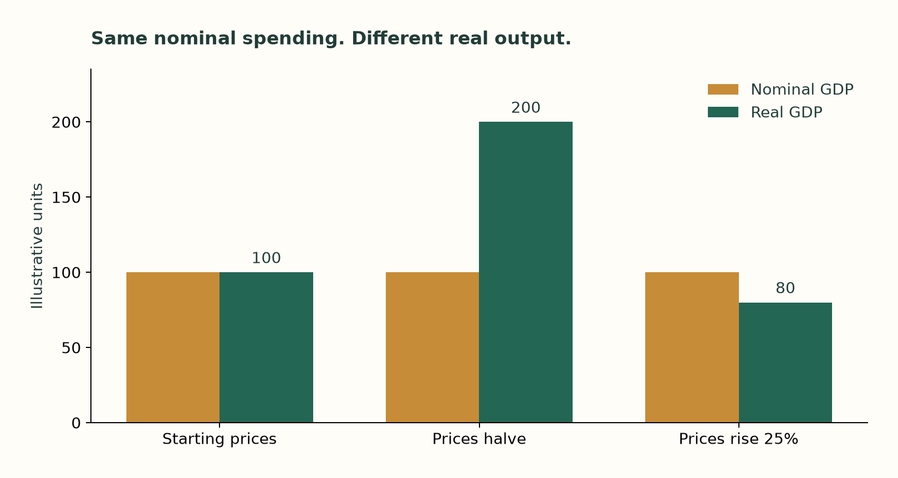

# Who buys what the machines make?

*A follow-up to “AI needs a customer”. Draft for review, 10 October 2026. All model numbers are invented examples, not economic forecasts.*

A machine arrives in a small town. It lets every business make twice as much. Nobody gets a pay rise.

The obvious question is who buys the extra output.

My first instinct is to look at the workers. Their pay packets have not changed. How can they buy twice as much? If the machine then takes their jobs, the question becomes harder.

But there is someone else in the town. The owners receive income too. And there is something else that can change: the price.

That is the distinction I wanted to make more concrete after listening to Dylan Patel on [Big Technology](https://www.youtube.com/watch?v=LwMtHI7BHWI&t=909s). He described a world in which labor income stays roughly flat while the rest of the economy grows much faster. I had already discussed falling prices, investment and ownership in [AI needs a customer](https://krystofmincev.substack.com/p/ai-needs-a-customer). This time I wanted to follow the money all the way around.

So I imagined a town small enough to fit in a spreadsheet, and modeled it in code.

## Ten businesses and twenty people

There are ten workers and ten owners. There are two businesses extracting raw materials, two processing them, two supplying intermediate goods and services, two making things people consume, and two making equipment for businesses.

No stage has a single supplier. That does not magically create perfect competition: the model does not calculate how rivals set prices. It lets us change prices and see what follows.

For spending, the code pools the workers into one household group and the owners into another. It does not calculate the individual budget of each partially displaced worker. Workers can divide their time across businesses. Each employed worker earns 6 per period, so ten workers receive 60. There is no government, foreign trade or borrowing. All figures are invented money units. A period is simply one round of the model, not a prediction about a calendar year.

We start with 100 of final output. Households buy 80; businesses buy 20 of newly produced equipment.

The businesses also buy from one another. Add all ten companies' invoices and turnover is 169.4. That does not make GDP 169.4. Intermediate purchases account for 69.4 of those invoices. Subtract them and value added is 100. Counting both the steel and the finished machine as separate final output would count part of the machine twice. [BEA's definition](https://www.bea.gov/help/faq/1197).

The 100 becomes income: 60 goes to workers and 40 to owners. For now, “owner income” means gross operating surplus. It has not yet been reduced for worn-out capital, taxes or interest.

Workers spend their entire 60. Owners spend half their 40, or 20. That gives us the 80 of household consumption. The other 20 buys new equipment.

In the payment simulation, owners explicitly put saving into the businesses before the equipment orders are paid. Money moves from owners to businesses, through suppliers, and back to households as wages and distributions. We do not create a second 20 by counting the financing and the equipment purchase twice.

The town starts with enough cash to make these payments. Across every account, the amount of money stays fixed. Money can pay for more than one transaction as it passes from hand to hand.

## A better machine does not create an order

Now double the town's productive capacity. Keep pay, prices, spending habits and equipment purchases unchanged.

Actual GDP remains 100.

The businesses could make more. They have no additional orders. In this version they produce to order, so unused capacity stays idle. If they produced goods anyway and kept them in a warehouse, those goods would initially count as inventory investment. That is another possible response, but it is not a lasting customer. [How inventories enter GDP](https://www.bea.gov/resources/methodologies/nipa-handbook/pdf/chapter-07.pdf).

This is the part of the demand argument that survives intact. Better technology and higher realized output are different things.

Now let prices fall by half, with enough capacity available. The same 100 buys 200 units of final output. Workers still receive 60 and buy 120 units instead of 60. Owners buy 40 instead of 20. Businesses buy 40 units of equipment instead of 20.

**Nominal GDP stays at 100. Real GDP doubles. Nobody needs a nominal pay rise.**

This is a deliberately strong assumption: the price of every consumption and investment good falls together. Rent, debts and groceries do not necessarily follow the price of software. But it answers the logical question. A fixed money wage bill is not a ceiling on real GDP.

Reverse the experiment and raise the common price by 25%. With the same spending, real output falls from 100 to 80. Charging more does not, by itself, make the town richer. Better quality might change the comparison, but quality improvements would need to be measured separately.

*Toy results. Same wage bill, spending rules and nominal equipment expenditure; all prices move together. This is not a model of any particular firm's ability to raise its price.*

## Let one worker go. Then three. Then five.

Return prices to their original level. Owners continue to spend half their income. Businesses continue to buy 20 of equipment. Automation lets them maintain production capacity with fewer workers.

The comparison after incomes and spending have adjusted looks like this:

| Workers who lose their wages | Wage bill | Household consumption | Equipment purchases | GDP |
| ---: | ---: | ---: | ---: | ---: |
| 0 | 60 | 80 | 20 | 100 |
| 1 | 54 | 74 | 20 | 94 |
| 3 | 42 | 62 | 20 | 82 |
| 5 | 30 | 50 | 20 | 70 |
| 10 | 0 | 20 | 20 | 40 |

These are conditional results, not a law that a particular number of layoffs causes a recession. The first lost wage lowers GDP in this version because we have held the offsets still.

There is a result here that initially feels strange. Owners' aggregate income remains 40 in every row.

At an individual business, cutting pay can increase profit. Across the whole town, lower wages also mean lower sales. With these particular spending rules, the loss of sales eventually absorbs the payroll saving. Their eventual aggregate income flow does not rise simply because every business cuts its wage bill. Their wealth is a separate matter: during the transition, cash can move from workers to owners.

Change the spending rules and that result changes too. The companion research includes a case in which workers also save some income; there, profits rise while GDP falls. The point is to follow the consequences of an assumption, not choose the one that produces the most dramatic ending.

The last row also answers a question I had not made concrete enough before. **Even after every wage disappears, GDP does not necessarily disappear.** Owners buy 20 of consumption and firms buy 20 of equipment. There is still production and income.

The former workers, however, buy nothing. They are still alive in the model. They have simply lost their claim on its output.

That is a distributional catastrophe which an aggregate GDP figure alone does not describe.

## Three ways to change the ending

First, owners can consume more. If they spend 80% rather than 50% of their income, the town with ten employed workers has GDP of 160 under our other assumptions. This requires enough production capacity. The additional demand comes from a different spending choice, not a new worker.

Second, businesses can buy more equipment. After all ten jobs disappear, increasing investment from 20 to 50 restores GDP to 100 in the fixed-price model. Owners receive 100, consume 50 and direct the other 50 into equipment.

GDP is back. Household consumption is only 50, down from the original 80. Former workers still consume nothing. Restoring GDP and restoring their lives are different objectives.

Third, income can reach the former workers through another route. In the same zero-job economy, a transfer of 60 from owners to the former workers restores GDP to 100, consumption to 80 and investment to 20. Owners' gross income is 100; after the transfer they keep 40 and consume 20. The recipients consume 60.

The transfer is counted once. It changes who spends income; it is not another 60 of production. Broader ownership can accomplish something similar: in our separate payment experiment, giving the worker households 60% of dividends lets the economy approach the original output even after wage income ends. Ownership and employment are different claims on income.

These examples assume that transfers can be collected and that equipment purchases can be financed. They are not free policy recommendations. They show why a statement about jobs alone leaves the macroeconomic outcome unfinished.

## What does the falling labor share tell us?

Patel's historical observation has support, with a necessary definition. BLS reports that labor compensation's share of **US nonfarm business output** was 62.8% in the fourth quarter of 2000 and 52.8% in the second quarter of 2026. That is a decline of ten percentage points in this particular series. It includes compensation beyond wages and is not the wage share of the entire economy. [BLS, September 2026](https://www.bls.gov/opub/ted/2026/labor-share-at-its-lowest-level-52-8-percent-in-second-quarter-2026.htm).

A smaller share does not mean a smaller amount. If output rises from 100 to 150 and labor's share falls from 60% to 50%, labor income rises from 60 to 75. Whether a particular household benefits depends on employment, hours, prices and which workers receive that income.

The historical series does not prove Patel's forecast. It does show that labor income and total output need not grow at the same rate.

## The question after the job disappears

The toy town changes how I would phrase my original concern.

Somebody must buy the market output, or hold newly produced capital and inventories. That somebody need not be a wage earner. Owners can consume. Businesses can invest. Prices can fall enough for unchanged spending to buy more. Income can also be distributed through ownership or transfers.

None of that guarantees a good transition. In the version with unchanged prices, spending habits and investment, layoffs reduce demand and production. In other versions, GDP grows while former workers get nothing. In another, falling prices make unchanged wages worth much more.

The machine answers what the town could produce. The spending rules determine what it sells. Ownership determines who gets to enjoy it.

The person wondering whether to buy the car needs all three answers.

---

*The [interactive companion](../site/index.html) lets you change the assumptions. The [model specification](../model-spec.md) explains the equations, payment timing and omitted mechanisms. These are reproducible examples, not estimated probabilities. Part two asks whether the investment cycle can keep going after every job has gone.*
