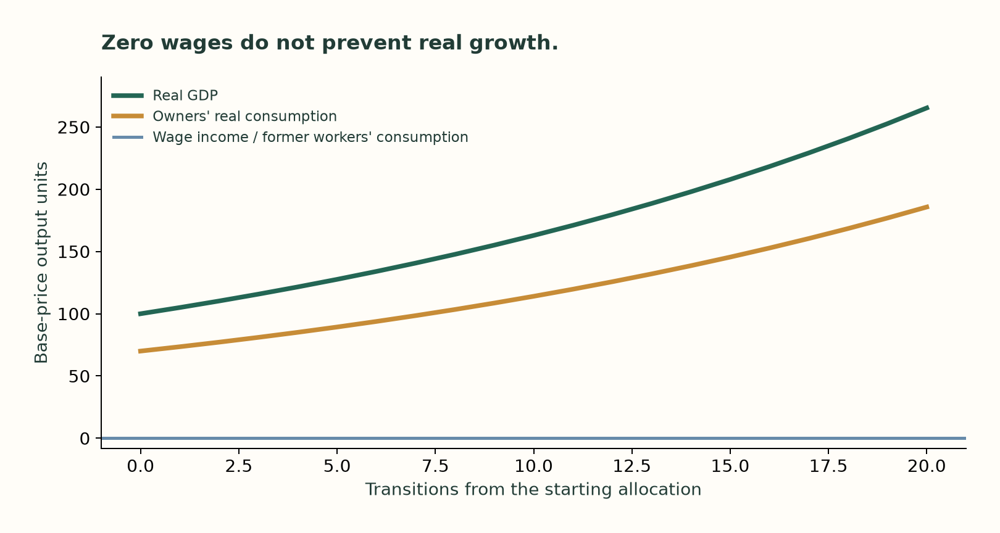
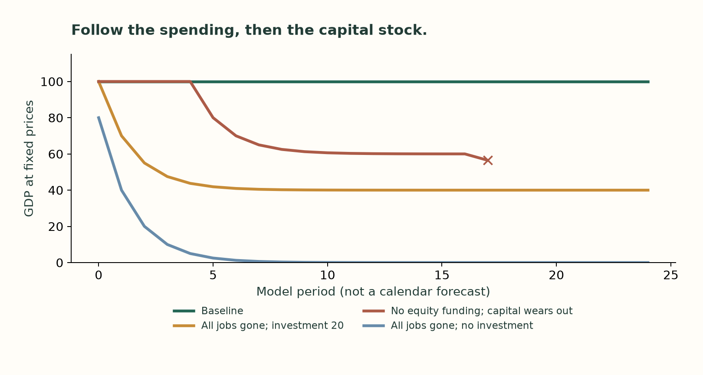

# An economy without paychecks

*Part two of the toy-economy study. Draft for review, 10 October 2026. Model periods are not calendar-year forecasts.*

The factory makes machines. The machines build another factory. That factory makes more machines.

GDP rises. Nobody buys a better dinner.

There is something uncomfortable about that picture. It is also useful, because it separates three questions we often compress into one: can production grow, can the spending be financed, and does anyone become better off?

In [part one](01-who-buys-the-output.md), our ten-business town could keep producing after all ten workers lost their wages. Owners still consumed, and firms still bought equipment. But a table describing one period does not tell us whether the arrangement lasts.

For that, we need to carry the machines and the money into the next period.

## A world in which nobody has a job

Start with the strongest possible assumption. Machines can perform every required task: production, maintenance, management and the construction of replacement machines. Energy and raw materials are available on the same scalable terms. There is no hidden human workforce abroad.

This is an assumption about a hypothetical technology. It is not a claim about what today's AI can do.

The owners start with 200 units of productive capital. Each unit makes half a unit of output per period. Total production is therefore 100.

Ten percent of the capital wears out each period, so the town needs 20 units of replacement investment just to stand still.

Let the owners consume 70 of the output and buy 30 of new capital. At the end of the period, the town has:

**200 − 20 + 30 = 210 units of capital.**

Of the 30 invested, 20 replaces worn-out capital and 10 adds to the stock. GDP is gross production; subtracting the 20 of depreciation gives net domestic product of 80.

Next period that capital produces 105. The owners consume 73.5 and invest 31.5. Ten percent of the larger capital stock wears out, leaving 220.5.

Output and consumption are both growing by 5% per period. No wage is paid anywhere.

After twenty transitions, output is 265.33 and consumption is 185.73, compared with 100 and 70 at the start.

*An existence example: scalable capital-only production, no scarce complementary input, owners willing to buy the output, and prices that clear the market. This is not a 5% forecast for the real economy.*

Who buys it? The owners do. They buy both the consumer goods and the new capital.

Where does the money come from? This example keeps nominal expenditure at 100. Prices fall as physical production rises. By the twentieth transition, the common price is about 0.377 of its starting level. The same nominal spending buys more, and receipts return to the owners as gross capital income.

This growth model specifies a market-clearing allocation. The separate payment simulation checks cash transfers under its own fixed-price scenarios; it does not verify the exact payment path of this price-flexible growth example. We should not pretend that choosing a clearing price proves every company in the world will find it, or that every household expense will fall with it.

The growth condition is simple. New productive capital must exceed worn-out capital. If the fraction of output invested is `s`, output per unit of capital is `a`, and depreciation is `d`, then:

**Growth per period = s × a − d.**

Our example is `0.30 × 0.50 − 0.10 = 0.05`, or 5%.

Invest only 20% and the town merely replaces what wears out. Invest nothing and production declines. Introduce a fixed land, energy or material constraint and the growth path can hit a ceiling. Introduce diminishing returns and the constant 5% need not survive.

There is no maximum growth rate that follows from “ten workers” alone. The technology and these constraints determine what is possible. The spending and price assumptions determine how it is sold.

## GDP can grow without anyone enjoying more

Now make the owners invest every unit of output. In this mathematical version, the town grows even faster. Consumption is zero.

It is not a convincing story about why people would behave that way forever. We have not given them a reason to prefer an endless accumulation of machines to the services those machines might eventually provide. But the accounting does not reject the path merely because dinner is missing.

GDP measures production. It does not certify that the production is useful, equally shared, or worth its cost. We would need preferences, a purpose for capital, and measures of household outcomes to answer those questions.

This also clarifies the China analogy. A country can sustain substantial investment alongside relatively weak household demand. China also has exports, a government and a financial system, all absent from our starting town. IMF's recent consultation describes weak domestic demand and calls for a shift toward consumption; it does not describe an economy with no domestic consumers. [IMF's China report](https://www.imf.org/-/media/files/publications/cr/2026/english/1chnea2026001-source-pdf.pdf).

A current-account surplus, together with the usually smaller capital-account balance, corresponds to net lending to the rest of the world. The current account includes foreign income and transfers as well as the trade balance. Net lending can mean acquiring foreign assets or reducing foreign debts. [BEA explains these accounts](https://www.bea.gov/news/us-international-transactions-and-investment-position-release-additional-information). Foreign assets can earn income, be sold, or finance future purchases. The holders do not all have to redeem them together on a fixed date. Questions about their returns and eventual use are legitimate. They are not an accounting proof that a surplus must end after a prescribed number of years.

Our closed town cannot use foreign customers at all. It still has domestic consumption and investment. A buyer of newly produced equipment is a buyer of output.

## The transition is harder than the endpoint

Return to the payment simulation. We begin with 200 units of money spread across workers, owners and the ten firms. Everyone uses existing balances. There is no bank creating credit and no overdraft.

Workers spend from the income they received in the previous period. Owners do the same, consuming half their prior distributions. Owners explicitly provide equity financing for equipment purchases. Firms pay suppliers, wages and distributions. Every transfer has a payer and a recipient.

Remove all ten jobs at the start, but leave investment at 20 and prices unchanged.

GDP does not instantly fall from 100 to the eventual 40. The path begins:

**100 → 70 → 55 → 47.5 → 43.75 → … → 40.**

The first round is supported by cash and income inherited from before the layoffs. Worker balances are then spent without replacement wages. Owners initially receive more income, but spend only half of it; subsequent sales adjust.

The quantity of money has not vanished. It still sums to 200 across the accounts. The distribution and speed of spending have changed.

*Fixed prices and synthetic spending rules. The no-financing-recycling case ends when the model cannot pay contracted wages; that is a model stop, not a predicted bankruptcy date.*

Now keep all workers employed but turn off the flow of owners' saving into new equipment purchases. Firms can still use their own cash reserves. For five periods they do, and GDP remains 100.

Then those reserves are exhausted. Investment falls to zero. Consumer spending does not immediately disappear, but the equipment is no longer being replaced. Eventually capacity falls below the output needed to support the promised payroll, and the model stops with unpaid wages in its eighteenth simulated period.

Two mechanisms are at work: financing the purchases and maintaining productive capital. If we repeat the same example with machines that never wear out, the model can settle near GDP of 60, funded by workers' consumption, without reaching that payroll failure. Calling the original result simply “saving caused a collapse” would conceal the second assumption.

Real economies have additional responses: credit, asset sales, price changes, bankruptcy, policy and new forms of employment. Our deliberately narrow ledger shows what happens without them. It does not establish that investment everywhere must wait for previously saved household deposits. In real banking systems, lending can create deposits. [Bank of England](https://www.bankofengland.co.uk/quarterly-bulletin/2014/q1/money-creation-in-the-modern-economy).

## What this says about the AI revenue forecasts

The [Big Technology interview](https://www.youtube.com/watch?v=LwMtHI7BHWI&t=116s) puts roughly $2 trillion of next-year US capital spending across chips, data centers and the wider supply chain on the table. Later, the host restates a combined OpenAI and Anthropic revenue figure of $700 billion. These are forecasts, not established outcomes.

The revenue passage needs care. The automatic captions garble a unit, and the discussion moves between a December level and a larger end-of-2027 possibility. It does not cleanly establish whether each number is revenue earned over the whole year, or the December revenue pace expressed as a year's worth. I would not build a precise forecast on that ambiguity. The [research notes](../research/interview-notes.md) preserve the relevant timestamps.

The related [SemiAnalysis financing episode](https://www.youtube.com/watch?v=XlnyFCviN4o&t=397s) describes $11.3 trillion of cumulative 2024–2029 AI IT and data-center capex. That is a different horizon and scope from a single year's US spending.

The toy town cannot validate these numbers. It does show why flat wage income is insufficient to dismiss them.

An enterprise can redirect existing supplier spending into an AI bill. It can reduce payroll and buy machine services. It can invest in new software or research where the spending qualifies as capital. Owners or investors can finance that expenditure. Customers can pay for additional or better output. Which route dominates matters for both demand and distribution.

None requires AI revenue to equal an equivalent increase in total GDP. Suppose a company sells 100,000 of final services and pays a domestic HR supplier 10,000. The two firms' combined value added is 100,000. If the company performs the HR work internally using 10 of domestic AI services and final sales remain unchanged, combined value added is still 100,000. The supplier mix and income distribution change. The avoided 9,990 invoice is not automatically lost GDP.

This is a qualification to some of the discussion of AI's [“dark output”](https://newsletter.semianalysis.com/p/ai-dark-output-the-visible-cost-of). Measuring cheaper or better services is difficult, as [OECD explains](https://www.oecd.org/en/publications/oecd-compendium-of-productivity-indicators-2026_734a5e68-en/full-report/productivity-patterns-across-industries_8238f2eb.html). Moving paid household services into unpaid household production can also cross [the statistical production boundary](https://www.bea.gov/resources/methodologies/nipa-handbook/pdf/chapter-02.pdf). But internalizing an intermediate business input is not the same event. We must consolidate the supply chain before drawing a conclusion. [BEA on value added](https://www.bea.gov/help/faq/1197).

Nor should we add lab revenue and every investment or supplier invoice together and call the sum new GDP. Some are intermediate transactions, some are newly produced capital, and some are financial commitments rather than current production. Imports matter when translating global spending into one country's GDP.

The payback question also needs more than revenue. Electricity, employees, maintenance, research, depreciation and finance consume resources or cash. A large top line does not establish an adequate return on a large capital bill.

## What would make the optimistic case work?

I would want to see customer benefits become paid demand; enough of that demand become cash flow to maintain and expand useful capacity; and households retain access to the output through pay, lower prices, ownership or transfers.

Those are separate tests. A lab can take revenue from another supplier without expanding GDP. GDP can grow while many households become poorer. A technology can create substantial benefits which are only partly reflected in measured GDP. A financially successful investment can still distribute its gains narrowly.

The exercise has made me less comfortable with an argument that stops at “workers will have no money.” It has also made me less comfortable with one that stops at “the machines will be productive.”

In the small town, both can be true. What happens next depends on who owns the machines, what those owners buy, how prices adjust, and whether the machines remain worth building.

The factory can make another factory. The question is what kind of life the town is building around them.

---

*Read the [interactive companion](../site/index.html), [model specification](../model-spec.md), and [source-grounded economics note](../research/economic-foundations.md). The model demonstrates possibilities under declared assumptions. It does not assign probabilities to them or forecast AI revenue, GDP, employment or investment returns.*
