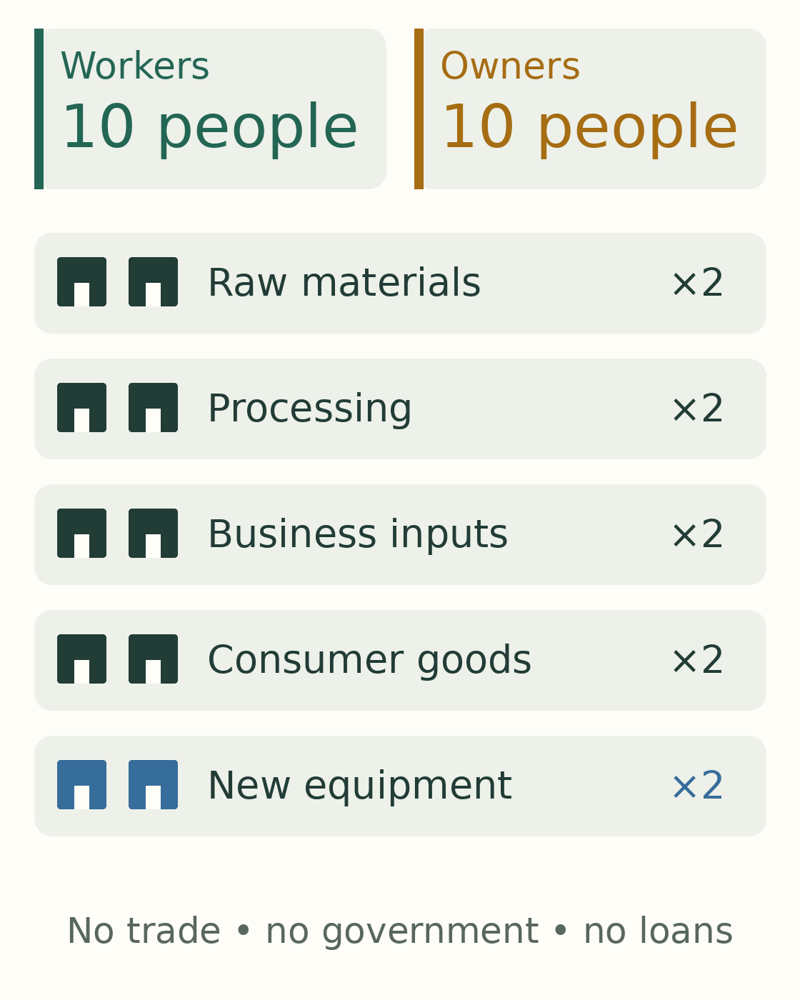
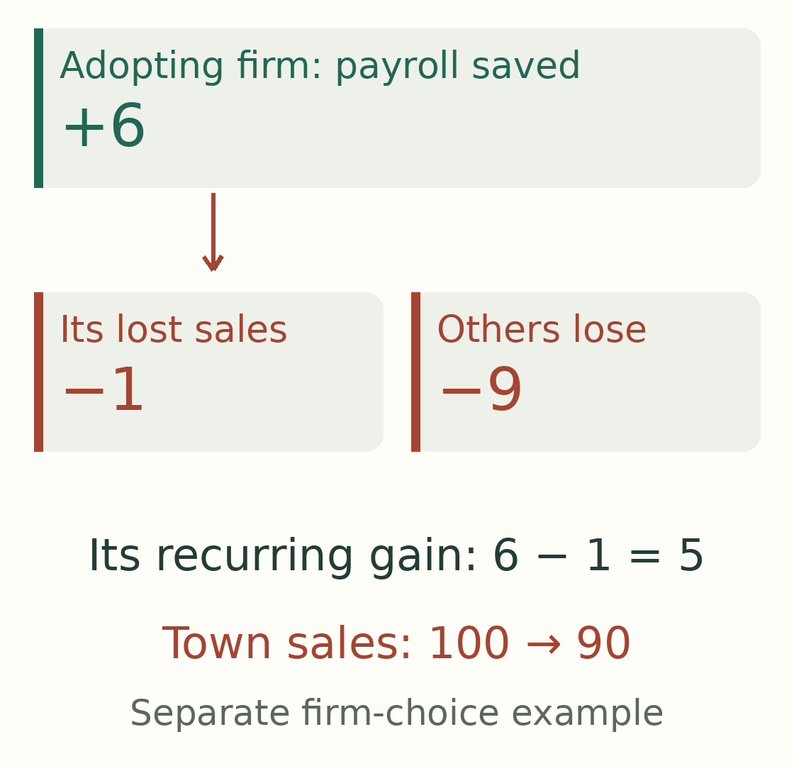
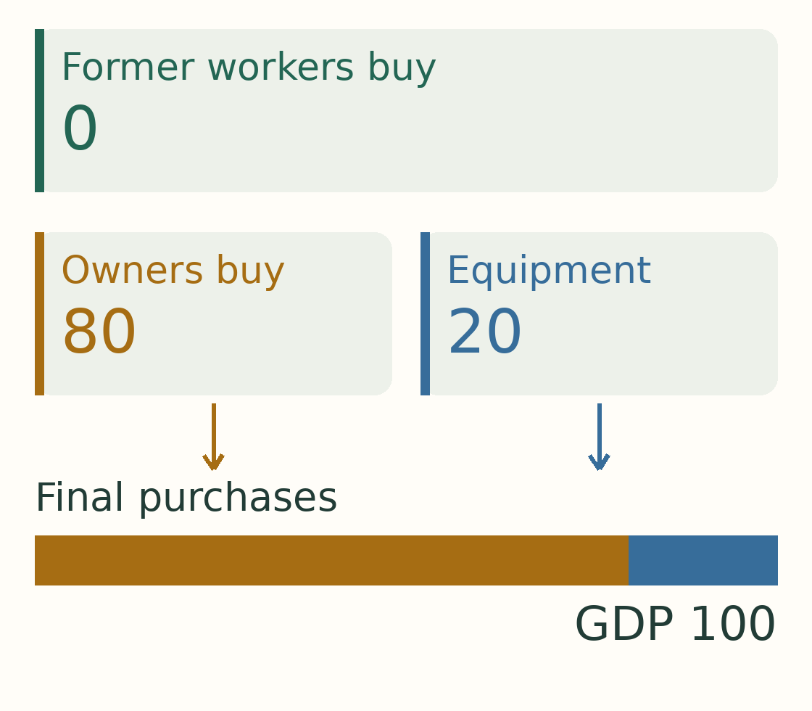
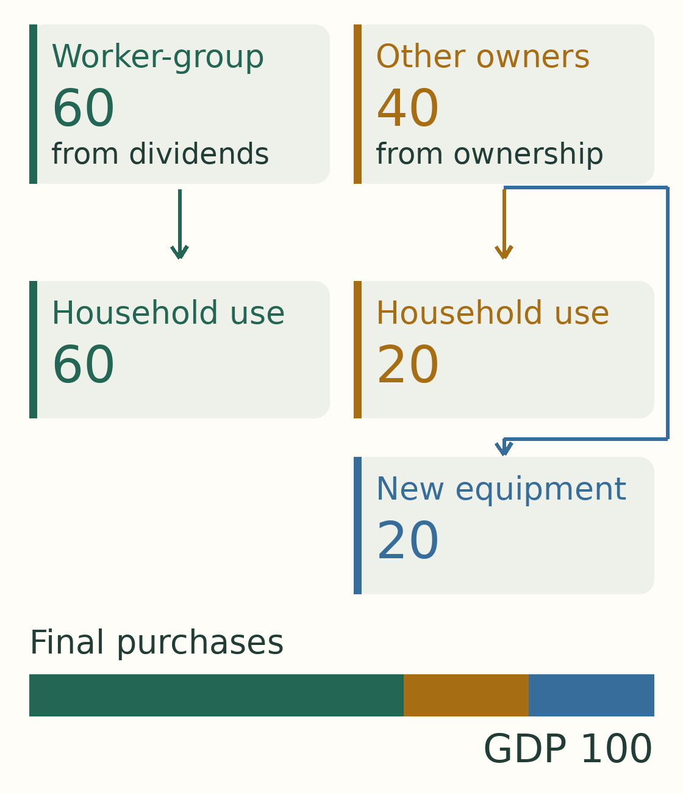
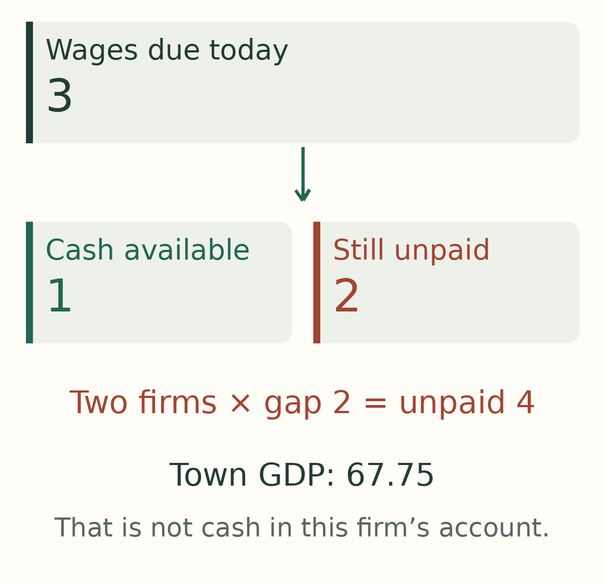
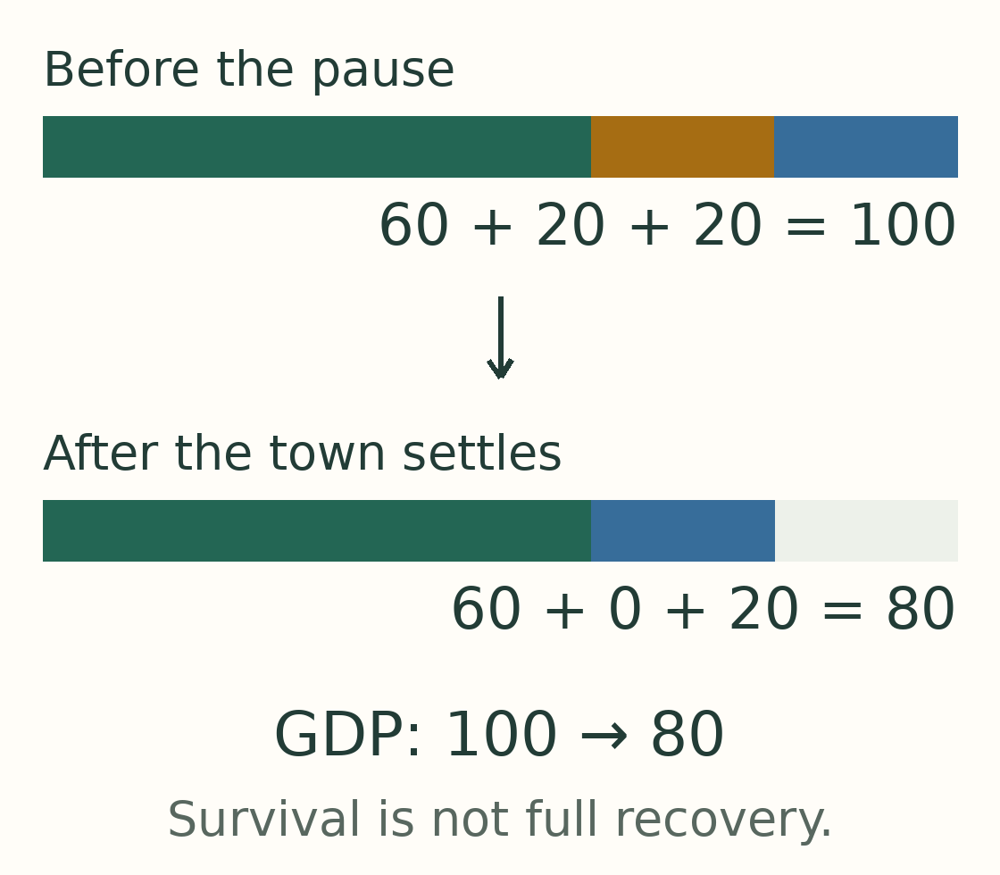
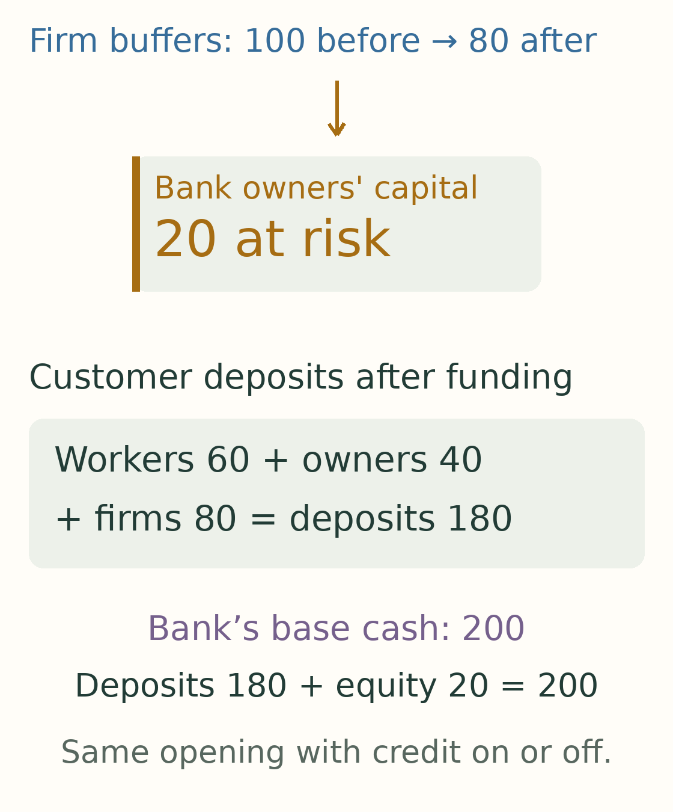
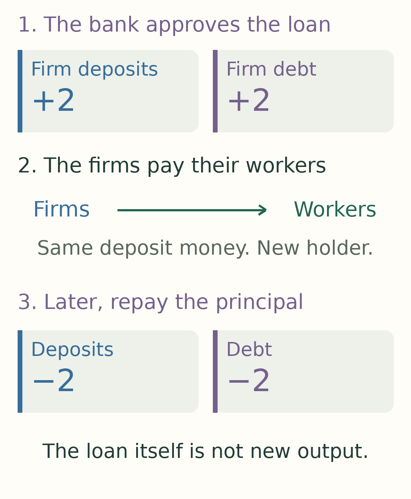
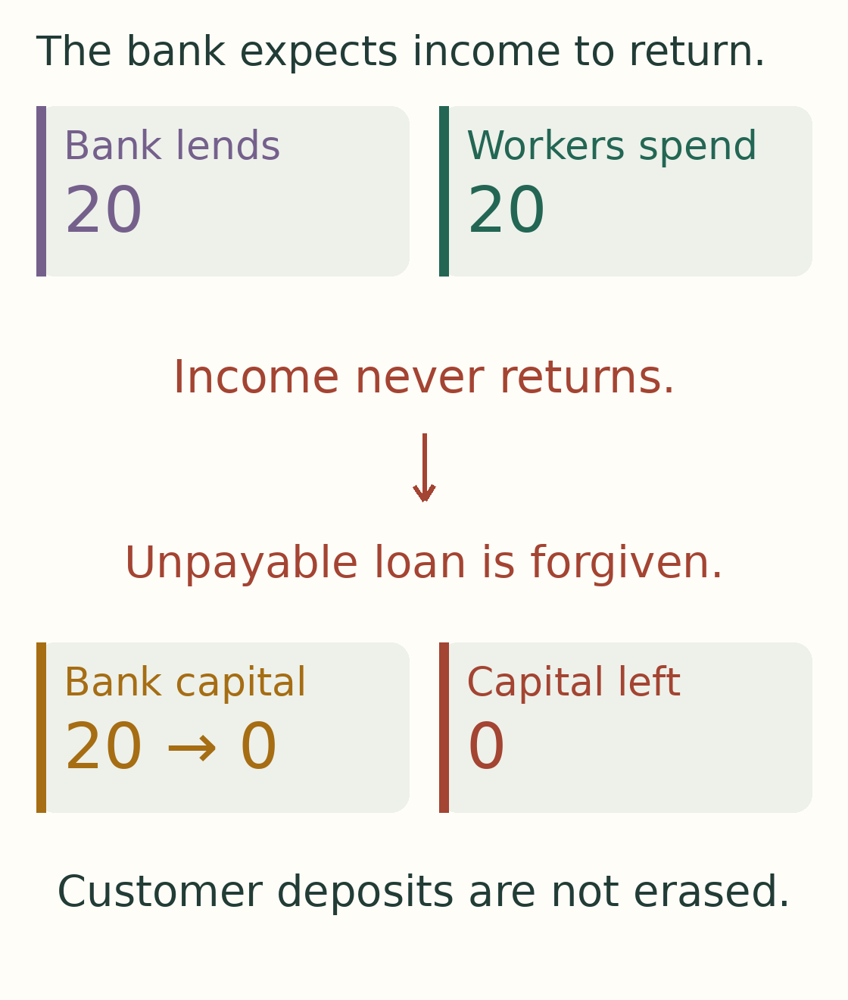

# Who buys the output when the paychecks stop?

*An economy can run without wages. Following the money through ten businesses shows what it takes—and where it can go wrong.*

**This is the static illustrated edition. [Follow the same story with step-by-step animations →](../site/03-when-the-economy-breaks-animated.html)**

*Draft for review · Illustrated edition, 11 October 2026 · A follow-up to [AI needs a customer](https://krystofmincev.substack.com/p/ai-needs-a-customer). All numerical examples are invented.*

In the first article, you were thinking about buying a car. The battery was better, the price was lower, and your employer was announcing an automation programme.

You kept the old car.

Now walk across the road to the business that employs you. Its owner has a decision to make. A machine can do the work for less. Her competitors are considering the same purchase. Keeping every employee might feel safer for the town, but it could leave her business at a disadvantage.

Your paycheck is her cost. It is also part of the car dealer's revenue.

That was the tension in the first article. This time I wanted to follow it further. What happens after the car dealer loses the sale? What does its supplier do? And could the town eventually run quite happily without paying anyone a wage?

So I built a town small enough to follow the money around. We will walk through it once before changing anything. Then we will return to the same town and try three different endings.

## First, meet the town

There are three groups to keep in view: the people who work, the people who own businesses, and the businesses themselves.

The workers and owners are households. They buy food, clothes, transport and other things for their own use. Economists call those purchases **consumption**. It is an ordinary word for buying things to live with, not just things that get used up immediately. Buying the car counts too.

Businesses buy things as well. Some purchases go into making another product. Others are new equipment that helps them produce in future. We will call the second kind **investment**.

Here is the whole cast. You do not need to remember the names of the businesses. They are here so we can follow money from one part of the town to another.

*Keep these groups in view. Green identifies workers, gold identifies owners, and blue identifies equipment purchases later in the story. Workers remain in the town even if their wages disappear. The diagram shows the groups, not every connection between suppliers.*

We leave out foreign trade, government and borrowing. There is no overseas customer to rescue weak sales, and no bank to lend a struggling firm more money. Those things matter in the real world. Removing them lets us see what the town can sustain on its own.

A “round” below is just one pass through the model. It is not a year or a month. The amounts are invented money units. Initially, prices stay unchanged, so lower spending means less output sold.

## Follow one round before changing it

Imagine that the town has finished a normal round of business. Households bought things for themselves. Businesses bought new equipment. Together, those final purchases came to **100**.

That is our starting GDP: the value of the town's final output during the round.

We do not add every bill between businesses on top. If a supplier sells metal that goes into a machine, counting both the metal and the entire finished machine as final output would count the metal twice. We follow the value added through the businesses instead.

The production also creates income. Some goes to workers as pay. The rest goes to owners. For now, owner income is measured before subtracting the cost of replacing machinery that wears out.

*Read down the arrows. The town produces 100. Workers receive 60; owners receive 40. We have divided the same 100, not created another 100.*

Now pause at the households. The workers have received their pay. What do they do with it?

In this starting example, they spend all of it. Their purchases send the **60** back to businesses.

The owners behave differently. They spend half their **40** on things for themselves. The other half goes into the businesses to finance equipment purchases.

That last step matters. Money put aside can sit in an account. Here it is actually used: businesses order newly produced equipment, and its producers get paid. Moving money into a business finances the order; we count the equipment purchase once, not the financing transfer again.

*Follow the two columns separately. Workers' 60 goes to household use. Owners' 40 splits into 20 for household use and 20 for equipment. At the bottom, household purchases of 80 plus equipment purchases of 20 bring us back to 100.*

We have completed the circle. Businesses paid income to households. Households consumed or financed equipment. Those purchases became revenue for businesses again.

You can read the GDP equation as a description of the two things being bought:

**GDP = household purchases + purchases of new equipment.**

That is the starting town. The question now is what happens when one business changes its part of the circle.

## Why the owner buys the machine

Return to our business owner. Suppose the machine lets her avoid a wage bill while keeping production going.

It is tempting to say that the wage simply vanishes. But the saving can become income for an owner or supplier. What happens next depends on who receives that income and what they buy with it.

There is also a reason our owner might adopt even if she worries about the town's customers. She captures her own payroll saving. The lost spending is spread across many businesses.

To make that visible, briefly use a separate, simpler example: ten equal businesses, each receiving a tenth of the town's sales. It isolates the owner's incentive; it does not pretend that all ten businesses in our supply chain have identical accounts.

Under the spending response we will explore shortly, avoiding one wage of **6** eventually reduces town sales by **10**, because equipment orders fall as well. Our owner bears only a tenth of that sales loss.

*Look at the adopting firm first: 6 saved, 1 of sales lost, leaving a recurring gain of 5 before installation costs. Then look across the town: the other businesses bear the remaining 9 of lost sales.*

The machine still has to be worth its purchase price. A badly placed firm might close instead of buying one. We tested that choice too, and it changes the outcome.

The narrow point is enough for our story: **a saving can make sense inside one company's accounts while weakening customers elsewhere.**

Now return to the original town and let automation reach every business. To give the idea its strongest chance, assume machines can do all the required work, including making and maintaining other machines. This is an imagined technology, not a description of today's AI.

All wages can now disappear. What happens to the purchases that used to follow them?

## Three ways the town can end up

Each of the following examples starts from the same town. They are alternative endings, not three events that happen one after another. The difference is what people and businesses do with income after wages stop.

### 1. The paychecks stop, but purchases continue

The owners still own the businesses. If those businesses can produce without workers, the owners can continue receiving income.

In this run, they choose to spend more of that income on themselves than they did at the start. Their purchases, together with equipment orders, fill the gap left by wages.

*After spending has adjusted, owners buy 80 and businesses buy 20 of equipment. Output stays at 100. The former workers' purchases are zero. They have lost access to output even though the output still exists.*

The equipment purchases replace what wears out, so production can continue.

**The economy survives. The former workers' access to it does not.**

That is an important distinction. A healthy total does not tell us whether the person considering the car can afford it.

There is another way to keep purchases going. Return to the starting income split, but change how the former workers receive their share. Give them ownership income—dividends—in place of wages.

In this separate run, they receive **60** from the businesses. Other owners retain **40** and return to the original rule of spending half of it. We are not keeping the previous run's higher owner-spending rule.

*Compare this with the starting budget. The purchases are the same. What changed is the source of the worker group's income: dividends replace wages.*

The former workers no longer need a paycheck to buy things. They have another claim on what the town produces.

So an economy does not logically need wage earners to have customers. It needs people with purchasing power who use it. Whether those people include the former workers is a separate question.

### 2. The town gets smaller, then settles

Reset again. Former workers have no ownership income. Owners spend half their income, as they did at the start. Businesses keep ordering the same amount of equipment each round.

This time, those purchases do not fill the whole gap. Once income and spending have adjusted, the town produces less.

*Both bars use the same scale. At the start, green worker purchases help fill the bar. At the end, owners buy 20 and businesses buy 20 of equipment: GDP is 40. The blank space means less output sold, not money being destroyed.*

There is still an economy. It is smaller, and the former workers still buy nothing.

But we have smuggled in a large assumption: businesses keep ordering equipment after many of their customers stop buying.

An existing construction project or committed order might behave like that for a while. What happens when the owner opens next year's budget?

### 3. Fewer customers mean fewer machines

The owner sees weaker sales and postpones another machine. So does the firm next door. Equipment producers lose orders. Their suppliers lose revenue too.

Now let equipment orders follow recent sales. In this particular run, businesses order equipment worth one fifth of the previous round's output. Owners spend half their income on themselves. Former workers still have no income.

Let the workers finish spending their last paychecks first. They now receive no wages or dividends. The previous round’s **100** of income has all gone to the owners.

Take the next round slowly. Owners spend half, which is **50**. Equipment orders add **20**. Together, those purchases give businesses new sales of **70**.

Here is the crucial step: that smaller sales total becomes the income from which the next round's purchases are made.

*Read one box at a time. Its final line becomes the next box's first line. The purchasing rules stay the same; the income they apply to gets smaller.*

Nothing here requires the machine to stop working. The owner can still produce more than customers want to buy.

As orders retreat, however, businesses eventually buy too little equipment to replace what wears out. Their ability to produce then shrinks as well. Weak sales have become a reason to invest less.

The money itself has not disappeared. The simulation has **200** sitting across all accounts throughout. That is a stock: the money there at a moment in time. The figures in the boxes are flows: purchases and income during a round. A town can have the same money in its accounts while spending less of it on new output.

Under these rules, output and consumption approach zero. The model does not say that every automated economy ends there. The first two endings already show otherwise.

It gives the concern in the first article a specific form: **lost wage spending can reduce sales, and falling sales can pull investment down too. Unless something replaces that spending, the decline can feed on itself.**

## The car can wait. Payroll cannot.

So far, we have looked at where spending eventually settles. A business can get into trouble before it arrives there.

Reset to the town with workers still employed. This time, equipment purchases pause temporarily, and each business keeps its own payroll commitments.

The equipment producers lose orders immediately. They still owe their employees money. Purchases made at the consumer businesses do not automatically move into the equipment makers' accounts.

*This is one firm's payday. It owes 3 and has 1 available, so 2 goes unpaid. Both equipment makers face the same problem. The town's GDP figure is not a shared bank account they can draw on.*

Across the whole town, GDP is still **67.75**, above the total contracted wage bill of **60**. Yet the firms that need to make these payments do not have enough cash. Of the promised wages, **56** are paid and **4** are not.

A loan, fresh investment from an owner, employees moving to another business, or a delayed payment might change what follows. Our model provides none automatically. It stops at the first missed payroll rather than inventing a bankruptcy process.

That is why speed matters, but not in one simple direction.

Gradual layoffs preserve wage spending for longer. In our uninterrupted comparisons, they delay the eventual shortfall without removing it. During an equipment-purchase freeze, however, keeping employees also means continuing to meet payroll. One slower layoff schedule runs out of cash before a faster schedule with the same intended employment endpoint.

That does not make faster dismissal better for the people losing income. It means that customers, bills and cash reserves have to be considered together.

Nor does surviving a shock guarantee a full recovery. Consider a separate run in which all workers remain employed, equipment purchases pause, and then buying resumes. This version lets their working hours shift between businesses as orders change. We are no longer keeping each firm’s own wage bill fixed.

*Before the pause, all three sources of purchases fill the bar. After this run settles, worker purchases and equipment orders return, but owners' household purchases do not. GDP is 80 rather than 100.*

Why does the gold part fail to return? The owners use their available cash to finance equipment first. Workers accumulated some money when goods were scarce, but our rule lets them spend only recent income, not those accumulated balances. The old pattern of purchases does not automatically restart.

Different rules for spending savings or financing equipment could change that result. The example is useful because it separates two questions we might otherwise confuse: did the town avoid missed payments, and did its customers return?

## How much could the town eventually produce?

Now set the demand problem aside for a moment. Suppose people are willing and able to buy what the machines make. Could output keep growing without workers?

To answer, we need to distinguish two jobs that new equipment can do.

Some replaces equipment that has worn out. That keeps the town running. Some adds productive capacity beyond replacement. That can let it make more.

*Buying a new machine does not necessarily give the town an extra working machine. It may be taking the place of an old one. Only additions beyond replacement expand the stock.*

If every extra machine is equally productive, and enough output goes into building more after replacement, production can grow indefinitely in the model. No additional wage is required. There is no finite ceiling because we have supplied no eventual limit to expansion.

Now try a less generous technology. Each addition to the machine stock produces a smaller addition to output. Eventually, equipment purchases merely replace what wears out. Output settles instead of growing forever.

For this part, we are counting real output—things produced—rather than cash moving around the earlier accounts. It is a separate experiment about productive capacity. Its quantities are invented too.

Suppose the town directs half its output into equipment. Under our chosen technology, it eventually produces **250** per round. Half, **125**, is available for household use. The other **125** replaces equipment.

Now suppose it directs all output into equipment. It eventually sustains a larger collection of machines and produces **500**. But maintaining that collection absorbs the entire **500**.

*Gold is output available for households. Blue is equipment replacement. The lower bar is twice as long, but it contains no gold at all.*

**Twice the GDP. Nothing for households to consume.**

In this model, investing half the output gives the highest lasting consumption. Investing all of it gives the highest lasting GDP. Those are different destinations.

GDP counts the replacement work. It does not tell us whether anyone would want that outcome. The underlying idea is familiar in growth economics: more machines can raise production while requiring so much upkeep that less is left for people. [MIT's growth lectures](https://ocw.mit.edu/courses/14-452-economic-growth-fall-2016/2b68057aa4e74410d00ae89a0c49752f_MIT14_452F16_Lec2and3.pdf).

These limits belong to this imagined technology. Scarce energy or materials could impose another ceiling. Better technology could move it. And a temporary peak during a boom and bust is different from a lasting production limit.

The number of workers alone cannot answer how much the town can produce—or how much people get to enjoy.

## What the investment story still has to explain

Return to the business owner. Her machine can save money. That is a useful start to an investment case.

She also needs customers after other companies make their own savings. The equipment supplier needs another order after the first wave of installations. The person who loses a wage needs another way to buy things—or the forecast must explain whose purchases take its place.

The optimistic path is possible in the toy economy. Ownership income can replace wages. People can consume while machines do the work. With the right technology and enough investment, their consumption can grow too. In the wider world, lower prices, new work and public support offer other ways to change the outcome.

The difficult path is possible as well. Lost wages reduce purchases. Firms respond to fewer customers by ordering less equipment. Both sources of spending weaken, while some businesses run out of cash before an alternative arrives.

The experiment does not tell us which path the real world will take. It makes the missing assumptions easier to see. A forecast of enormous AI revenue or construction spending still needs an explanation of the customers, the return on their purchases, and the income that supports the next round.

That brings us back to the car.

You might eventually buy it without ever receiving another paycheck. Dividends, shared ownership or another source of income could make that entirely ordinary.

But someone has to explain how that income reaches you. Until then, the better battery is still in the showroom, and the old car is still outside your house.

## One last experiment: give the town a bank

Before we leave the town, let us open one more door: a bank.

The equipment maker has customers coming back next month. She needs to pay her workers today. So far, our experiment has given her no way to connect those two dates.

A bank might make all the difference. But would it also help someone whose income never comes back?

### What changes when the bank makes a loan?

The bank also needs a cushion for losses. Its owners supply **20**, taken from the businesses' existing **100** of cash buffers. The businesses therefore begin with **80** in deposits. Workers still have **60**, and owners have **40**. Customer deposits total **180**; the other **20** has become the bank owners' capital at risk. There is no gift of extra starting wealth.

*The top transfer funds the bank. The middle box counts spendable customer balances afterward. The bottom line shows what backs the deposits and capital; it is not another pot to add to household spending.*

We give the comparison town exactly the same bank and starting balances, then disable lending. That keeps the comparison fair. It also means this is a fresh experiment: the equipment firms have smaller cash buffers than in the earlier payroll example.

Now we change one rule. Earlier, the town had a fixed amount of money. A bank loan can create a new deposit: money the borrower can spend. It also creates a matching debt. The borrower has more money available, but now owes the bank. Repaying the principal removes that deposit money again. This is the basic mechanism described by the [Bank of England](https://www.bankofengland.co.uk/quarterly-bulletin/2014/q1/money-creation-in-the-modern-economy).

*Follow one loan through three moments. Borrowing makes a payment possible. It does not, by itself, produce anything or add to GDP. Principal means the amount borrowed, before interest.*

Our experimental bank follows simple, fair rules. It charges no fees or penalties. It lends only within stated limits and when it expects enough future income for repayment. We test both free credit and interest of **1% per round**. That is an invented model rate; a round is not a year.

### A bridge that reaches the other side

Equipment orders now pause for five rounds. The workers remain employed, and wages still fall due. Orders return in round ten.

Without lending, the equipment makers run short in round seven. Across the town, **58** of the promised **60** in wages gets paid. The remaining **2** does not.

With lending, the bank supplies that missing money. When another payday arrives before the orders return, it lends again. The debt grows—but only while the firms are crossing the gap.

*These boxes show outstanding debt at different dates. Do not add them together. In the zero-interest run, debt reaches 14, falls after orders restart, and disappears in round 13. Every wage is paid.*

Interest does not overturn this result. At our **1%** rate, the firms still finish repaying in round thirteen. Total interest across the loans is about **0.43**. They use the money left from later sales after paying suppliers and workers. Owners receive profits only after the debt payment.

The bank has changed the outcome substantially. A temporary shortage of money no longer causes missed payroll. It has not prevented every fall in output, and it has not made an unprofitable business permanently viable. The bridge works because future orders provide the money to repay it.

Make the pause longer, while keeping credit finite, and that bridge can run out. In another run, lending limits are reached and wages go unpaid before orders return. **A company can run out of credit while the bank still has its capital cushion.**

### What if the borrower is a household?

Now try a different interruption. Workers lose two rounds of wages, then their wages return. Without credit, their purchases drop when the last paycheck has been spent.

The bank can keep those purchases going. In this run, worker households borrow **120 in total**, across two rounds, to keep buying **60** of goods per round.

But watch what happens when their paychecks return. Up to one fifth of the new wage goes toward the debt. While that full payment is needed, households receive **60**, pay **12** to the bank, and have **48** left for their next purchases.

*Green buys household goods. Purple repays principal and pays interest. The middle bar divides a wage of 60; it does not show 60 of consumption. These are totals for the worker group.*

At the **1%** rate, repayment finishes in round seventeen. The final payment is smaller, so purchases recover in two steps: first partly, then back to **60** in round nineteen. The households have paid about **6.35** of interest altogether.

At zero interest, worker households’ total consumption over the experiment is the same as without borrowing. They consume more during the gap and less during repayment. With interest, their total is lower by that interest bill. The bank distributes its interest profits to its owners, so the money has changed hands rather than vanished.

This is useful smoothing. It is not extra permanent income, and these runs do not show higher cumulative GDP from household credit.

### And if the income never comes back?

Here we must distinguish an honest expectation from a bad surprise.

If the bank knows that these households will have no future wages, dividends or other repayment income, it refuses to lend against that missing income. Fair lending is not an obligation to make a promise nobody can keep. In that run, credit does not rescue worker consumption.

Suppose instead that the bank expects wages to return and turns out to be wrong. In a smaller-loan example, it advances **20**. The households buy goods. The sellers receive the money. Then the hoped-for wages never arrive.

*At maturity, this experiment forgives the unpayable loan with no recovery. That is a loss for the bank, not repayment by the household. The bank's owners lose their 20 of capital. Forgiveness does not erase the deposits already created in the town; that money may have changed hands again.*

The model stops when that cushion is exhausted. In the larger-loan example, losses exceed the bank’s entire capital cushion. The bank becomes insolvent while other loans remain outstanding. We do not silently add a rescue, more shareholder money or losses for depositors. Each would need its own explicit rule.

So our bank can bridge missing income and spread a shock across dates. It cannot make an unlimited sequence of unpaid promises harmless. Nor can it manufacture goods that the town lacks the capacity to produce: in our capacity-limited comparison, credit fills a temporary spending shortfall without lifting the production ceiling.

The car at the beginning of this story could therefore be bought with a loan. That changes *when* you can buy it. It still leaves the question of *how* you will pay for it over time. The answer need not be a wage—our ownership-income experiment also repays its loans. But there must be income, assets to draw down, or somebody willing and able to bear a loss.

**The bank changes the route through the transition. It does not remove the need to explain who ultimately pays.**

*Optional: [follow the bank's accounts round by round](../site/banking.html), including new loans, repayments, interest, deposits and losses. The [banking model note](../research/banking-model.md) records the assumptions and limits; the [source note](../research/banking-foundations.md) separates textbook banking from our simplified rules. These loans finance payroll and household purchases; bank-funded expansion is outside this experiment. There is one bank with internal transfers, no bank runs and no separately modeled production of banking services.*

---

*Original analysis and diagrams with Codex assistance. The [interactive simulation](../site/shocks.html) lets you follow individual runs. The [technical specification](../research/shock-specification.md), [detailed results](../research/shock-cash-results.md) and [figure checks](../research/visual-data-review.md) retain the equations, timing, cash assumptions and numerical sources. The [firm-choice note](../research/strategic-game-note.md) explains the separate adoption example. These examples demonstrate possibilities, not their probabilities; they forecast neither GDP nor AI revenues.*
