# AI arrives one shop at a time. Who still buys?

*A follow-up to [AI needs a customer](https://krystofmincev.substack.com/p/ai-needs-a-customer) and [our first town experiment](../site/03-when-the-economy-breaks.html). An invented economy, not a forecast.*

**Static edition · [Follow the pictures step by step →](../site/04-ai-arrives-one-shop-at-a-time-animated.html)**

A shop discovers that AI can do part of its work. The owner sees a chance to save money. Across the street, another owner sees a reason to worry.

Neither is deciding what should happen to the economy. Each is deciding what to do with one business.

Our earlier paper asked what happens when paychecks disappear. This time, they disappear gradually—or become smaller, or stay exactly the same. Shops compete. Customers switch. An AI supplier sends invoices. Every payment moves between actual accounts.

The surprising part is that **the same technology can leave the town buying more, buying less, or working less.** The route matters.

## First, meet the town again

We have made the cast smaller so we can see who pays whom: two competing shops, five workers in each, an equipment maker and an AI supplier. The last two already operate automatically, using inherited infrastructure whose running costs we simplify away. The owners receive the businesses' profits. We pool their accounts, while each shop makes its own operating decisions.

Both shops sell the same useful basket of goods. Together, the workers buy sixty baskets each round and the owners buy twenty. Businesses also buy twenty units of equipment to replace worn-out machines. Those purchases make GDP one hundred.

A basket initially costs one coin. When prices change, real GDP keeps valuing goods at their starting prices, so we can see whether production grew. Replacement equipment counts in GDP too. Keep your eye on baskets: they tell us what people actually consume.

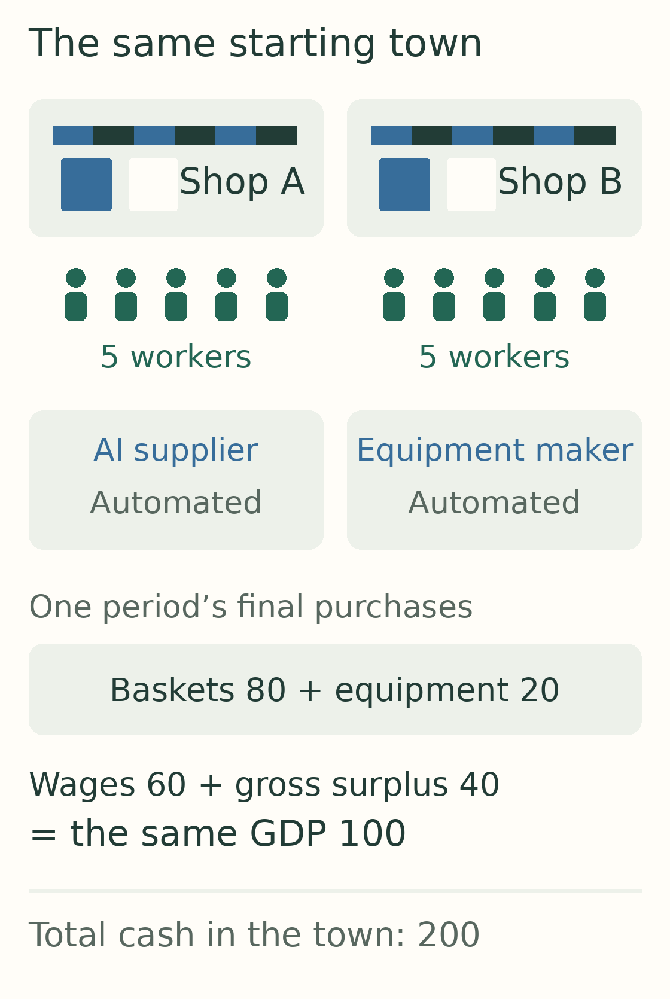

*This is our starting point. Workers buy most of the consumer goods. Equipment purchases are a separate source of demand. The two shops pay wages and distribute their profits; the equipment maker distributes its profit too.*

## The first thing AI removes is a task

Initially, making the town's eighty baskets requires ten full shifts—one from each worker.

AI first takes over a fifth of the tasks, then two fifths. Making the **same eighty baskets** now needs eight human shifts, then six.

That does not tell us what happens to anyone's paycheck. Ten people could share six paid shifts. Six people could keep full shifts while four lose their jobs. Everyone could keep their pay and spend the freed time making more goods. Or they could go home earlier.

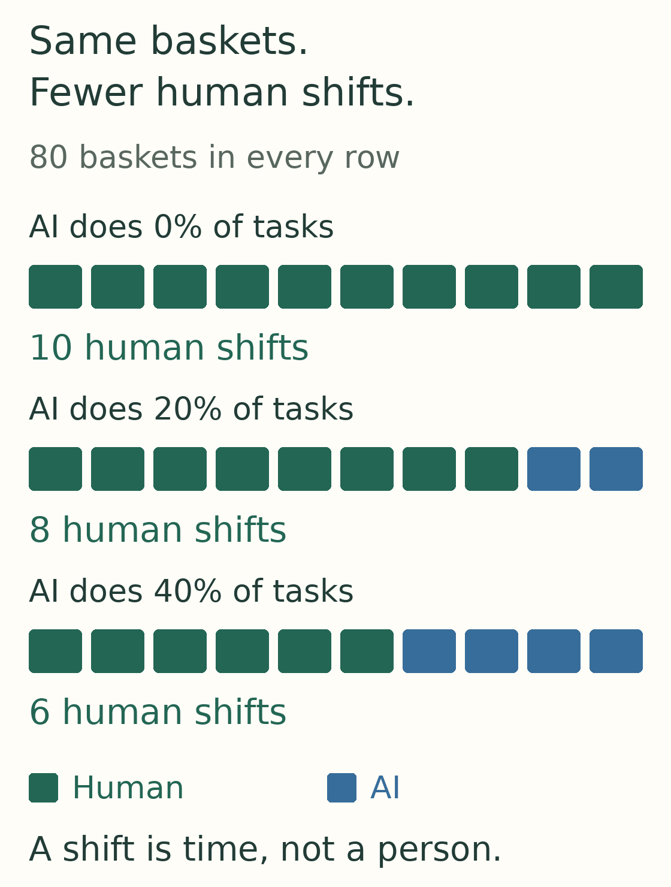

*The disappearing blocks are work required for the original output. A labor contract decides whether that becomes spare capacity, shorter paid time or lost jobs.*

## A good-looking decision for one shop

Start with hourly pay. A shop can trim paid work when AI takes over tasks. It compares the next round's expected profit with and without the first step of automation.

The forecast looks attractive: profit rises from ten coins to about ten and a half. The shop accepts. Its rival runs the same calculation and accepts too.

Then the missing wages reach the checkout. Workers have less money to spend. The shops cut prices, but prices fall less than workers' income. Once both shops have automated two fifths of their tasks, each earns only about five coins of profit.

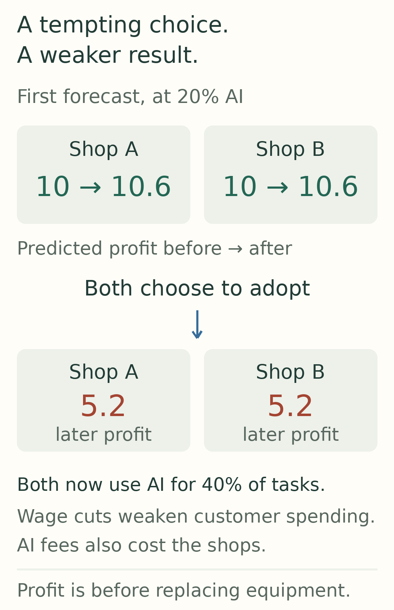

*The first number is a short-term forecast with the rival's inherited price and customers' current budget. The later result includes both shops adopting and household income changing. These are different moments in the same story.*

This is a deliberately limited decision rule: each shop considers its own next-step operating profit. It does not forecast the whole town's future, solve every possible price, or consider closing. The experiment shows how that rule can disappoint both shops. It does not prove that every rational business would behave this way.

There is another useful result. With protected salaries and the same AI fee, this rule rejects the first adoption step: the expected saving is too small. Cheaper AI changes that choice. A technology becoming available does not ensure a customer will buy it.

## Now change the contract

Return to the same starting town. For this comparison, we assign both shops the same gradual adoption path, even if their private choices would differ. Change how they use and pay for the freed time.

**Keep pay and make room for more sales.** Prices fall, wages stay intact, and workers can afford more baskets. Their purchases rise from sixty to about sixty-eight. Real GDP rises too.

**Keep pay and take shorter shifts.** The town gains time off. But it still pays the AI supplier, without expanding the shops' planned output. Under our pricing rule, baskets become more expensive. Workers buy about fifty-four. This can be an attractive exchange for leisure; the model does not decide that for them.

**Reduce paid hours.** Workers' total pay falls from sixty coins to thirty-six. Cheaper baskets soften the loss, but their purchases fall to about forty-one.

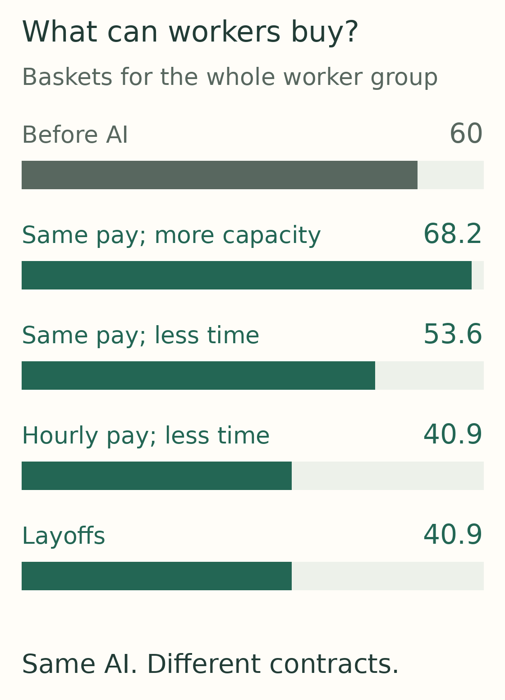

*All three paths reach the same 40% task automation. What workers can buy depends on pay, prices and output—not the technology percentage alone.*

Even the last outcome conceals a choice. Ten workers on shorter hours and six workers on full shifts produce the same aggregate wage bill here. The program now follows all ten household accounts separately. Four lost paychecks are not the same experience as ten smaller ones.

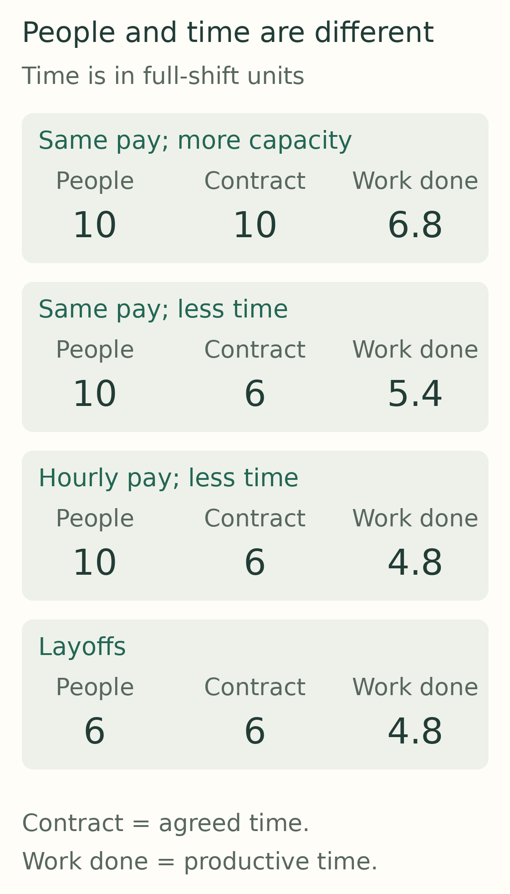

*The bottom two paths each pay for six full shifts. One spreads them across everybody; the other concentrates them among the people who keep their jobs. The top paths keep salaries protected.*

We also rotate the available shifts among workers. The town buys the same total amount as when everybody works shorter shifts, but individual paychecks become uneven from round to round. A steady town-wide wage bill can hide an unsteady household budget.

## Follow the AI invoice

The shops' disappointing profits do not mean all the money vanished. Some went to the AI supplier.

For the next picture, return to the protected-pay case with room for more sales. Its AI supplier belongs to people too. In this town it distributes its income. Whether the recipients spend it, finance equipment or leave it sitting in their accounts affects the next round's customers.

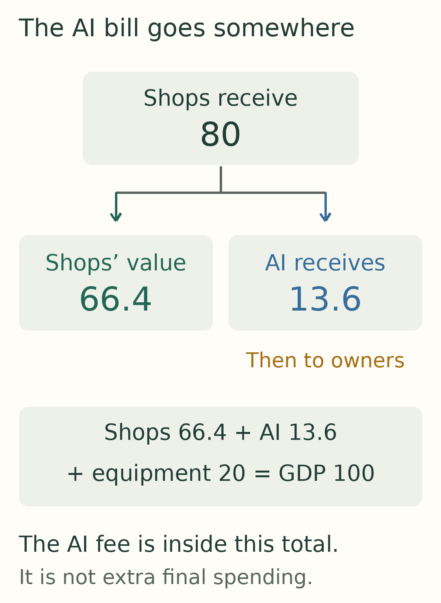

*The AI bill is a payment for an input. We subtract it from the shops' value added and count it at the supplier. Adding it on top of final purchases would count the same production twice.*

There are limits on the real side as well. The supplier can perform only so many tasks. Shops have finite equipment. More money cannot purchase baskets that cannot be made. A higher AI fee can also turn a promising installation into a poor deal.

## Gradual is gentler—under some rules

A slower transition gives the town more rounds with its old paychecks. That matters. It does not, by itself, replace the income that eventually disappears.

In the earlier ten-company economy, spreading the same job losses over time preserves more purchases during the transition but reaches the same eventual destination under each spending rule. In the new protected-pay case, slower adoption instead delays the benefit of cheaper goods.

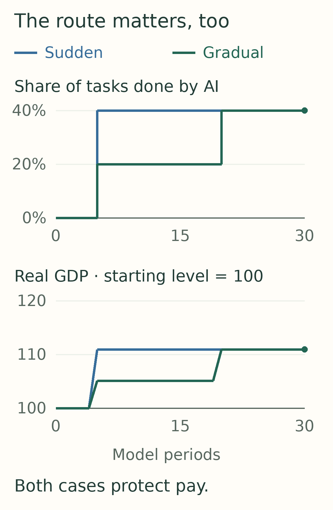

*Here the same protected-pay town reaches the same technology by different routes. The destination is similar; the baskets bought along the way differ. Gradual change is not automatically better or worse.*

Businesses can respond too. When one shop advances all the way to automation, an inflexible rival eventually cannot meet payroll in the tested path. Letting the rival trim paid hours as sales weaken keeps it operating through the experiment—but at a much smaller scale. Avoiding a business failure does not guarantee a healthy town.

Our separate banking tests make a related distinction. A loan can bridge a gap when income returns and repayment fits. Lending against income that never returns leads to refusal or losses. Even a real recovery can arrive too late for the original repayment schedule.

## Can the town prosper with no jobs at all?

It can—if people still receive income and enough goods can be produced.

We test the same fully automated town twice, with ample AI capacity. In one path, the original owners receive all dividends. Former workers eventually buy nothing. In the other, they receive a fixed sixty-percent right to the businesses' cash dividends—the profits actually paid out once the final automation step arrives.

They now buy more baskets than they did when everyone worked. Real GDP is higher as well.

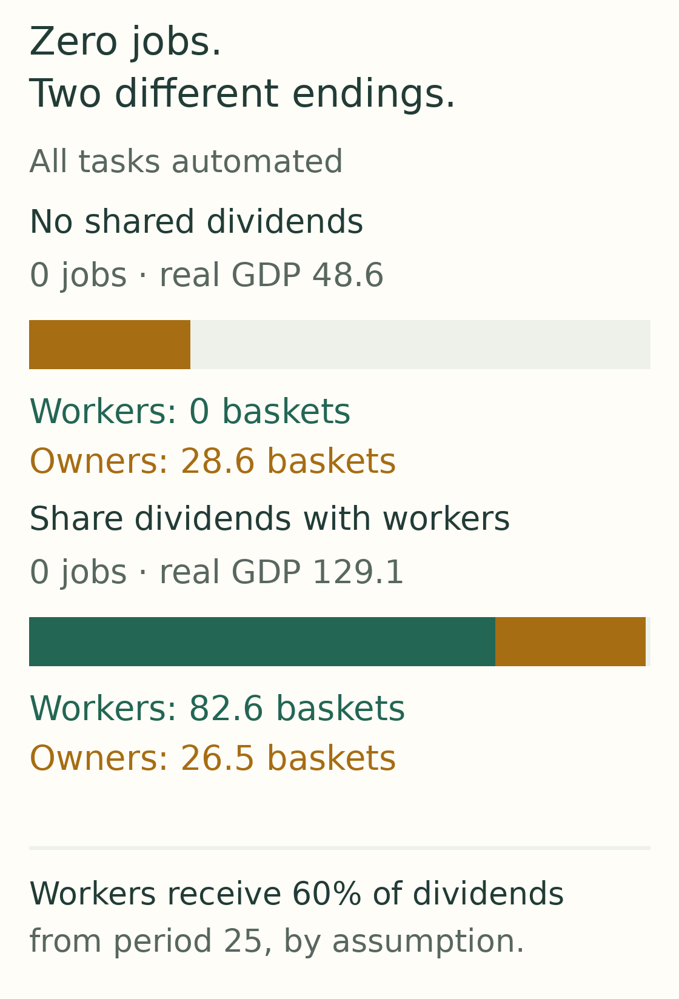

*The technology and starting accounts match. The second path gives former workers dividend rights; original owners still finance equipment. This is one explicit distribution arrangement, not a prediction that it will happen.*

Timing still matters. When equipment orders shrink with sales, introducing those rights after the downturn can stop the contraction without restoring the old level of activity. Sharing the income of a smaller economy does not instantly make the economy large again.

## What the repeated runs teach us

We also let the arrival of usable AI stages vary randomly between the shops, replaying the same opportunities under different rules. The randomness represents timing uncertainty; its probabilities are invented.

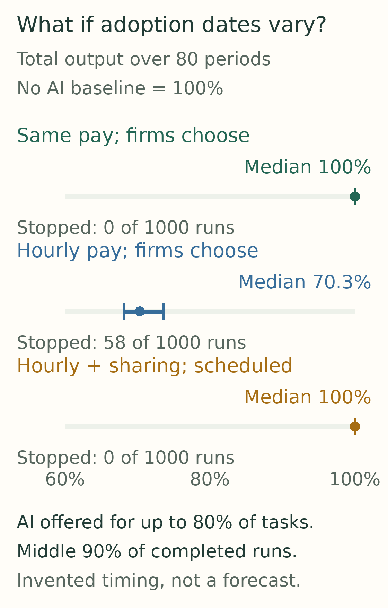

*These longer adoption paths allow up to 80% task automation. The picture reports the chosen sample and shows payment failures separately. Its ranges describe this experiment, not the probability of a real-world outcome.*

Sometimes the order of adoption changes how much income is lost before the rival catches up. Sometimes a firm runs out of cash first. When that happens, the simulation stops and says why. It does not pretend to know the outcome of an unmodeled bankruptcy or rescue.

## What if the AI supplier buys a shop?

We run a separate, deliberately narrow experiment for this. Hold customer budgets and prices fixed so we can see exactly what the supplier's purchase changes.

Buying an existing shop moves money to its old owner. The transaction itself makes no new goods. Automating that shop afterward can change production and work, but the ownership transfer is not the productivity gain.

Building an additional shop is different: somebody must produce its new equipment. That adds investment today. When the shop opens, however, it faces the same customers. In this controlled example, it takes some of the incumbents' sales while total baskets stay unchanged.

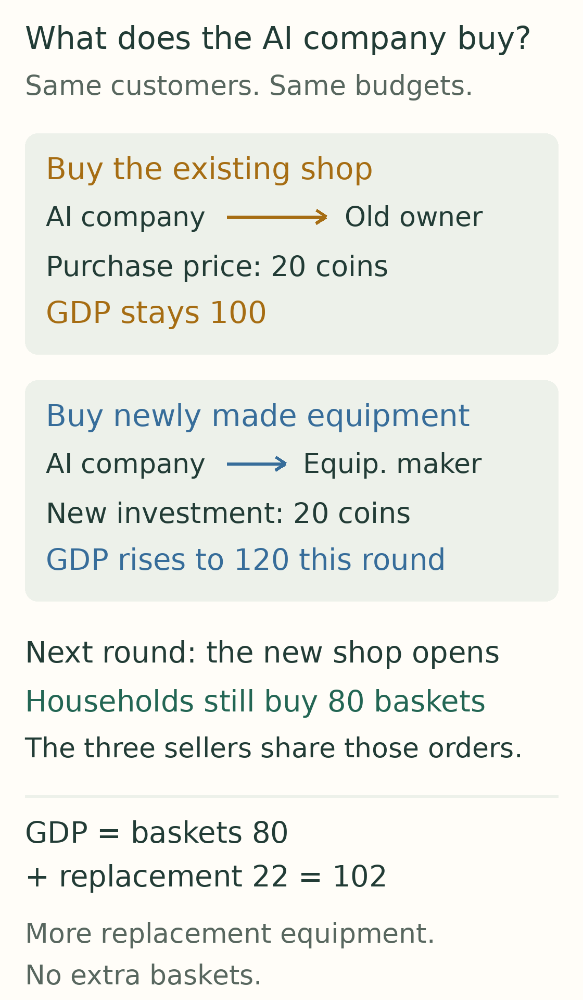

*Both purchases are paid from the AI supplier's existing cash. The additional shop also needs replacement equipment later. That raises gross GDP without increasing household consumption. This isolates transaction mechanics; it does not solve a takeover or entry strategy.*

## Where is the ceiling?

There are really two questions: how much **could** the town produce, and how much does it actually sell under our rules?

We test automation in one-percentage-point steps. In one protected-pay case, output peaks halfway through automation. Yet the town still has unused productive capacity. At the prices our shops choose, customers buy far less than the equipment and available task-hours could support.

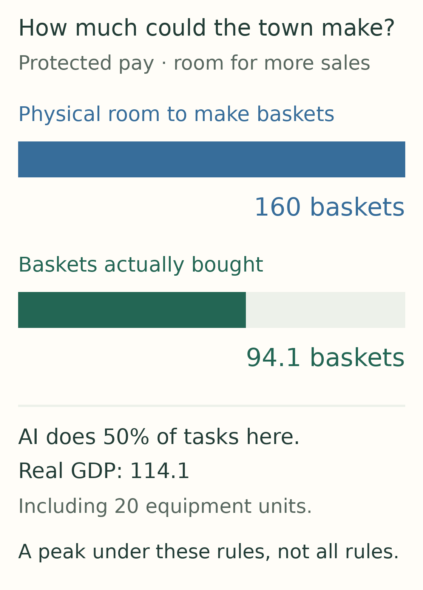

*The bars compare physical room with actual purchases at this grid's best completed endpoint. The peak depends on our pricing and capacity rules. Halfway is not a universal best amount of automation.*

A larger AI supplier changes the result. Some apparently better endpoints also turn out to be businesses slowly spending their cash reserves. Extend one such run a little longer and it misses payroll. Surviving eighty rounds does not establish that it can keep going forever.

There is therefore no single maximum covering every version of this town. GDP, worker purchases and free time are different objectives. The [full comparison](../research/adoption-frontier.md) separates physical limits, local peaks and completed-run maxima, including the cases that fail before the end.

## Back to the customer

The first paper's question survives: **who buys what AI helps us produce?** The answer becomes more precise.

A paycheck is one route to purchasing power. Lower prices and a claim on profits are other routes. Removing work can improve people's lives when those routes remain open. Removing their income without opening another route can shrink the market that businesses were trying to serve.

That is what the little town adds to the argument. AI does not choose the labor contract, the distribution of profits or the spending rule. Those choices help determine whether better production becomes more consumption, more leisure, a smaller market—or some mixture of all three.

---

[Explore every saved round](../site/adoption.html) · [Read the rules and limits](../research/adoption-model.md) · [Inspect the independent reviews and checks](../research/adoption-validation.md)

*The economic distinctions follow primary work on [automation and labor tasks](https://www.aeaweb.org/articles?id=10.1257/jep.33.2.3) and the [BEA's GDP accounting framework](https://www.bea.gov/resources/methodologies/nipa-handbook/pdf/chapter-02.pdf). All numerical outcomes come from our own uncalibrated simulation. The town has no foreign trade, government or new job creation; its automated supplier infrastructure is simplified. It cannot verify a forecast for OpenAI or Anthropic revenue, AI capital spending or real-world GDP.*
