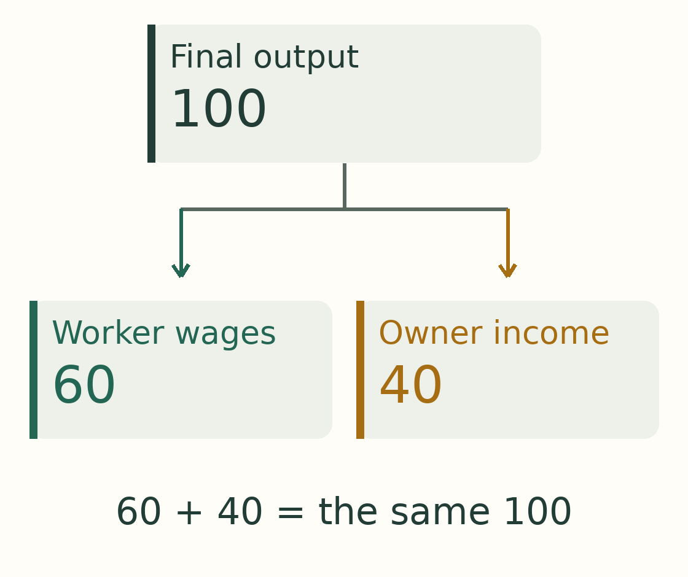
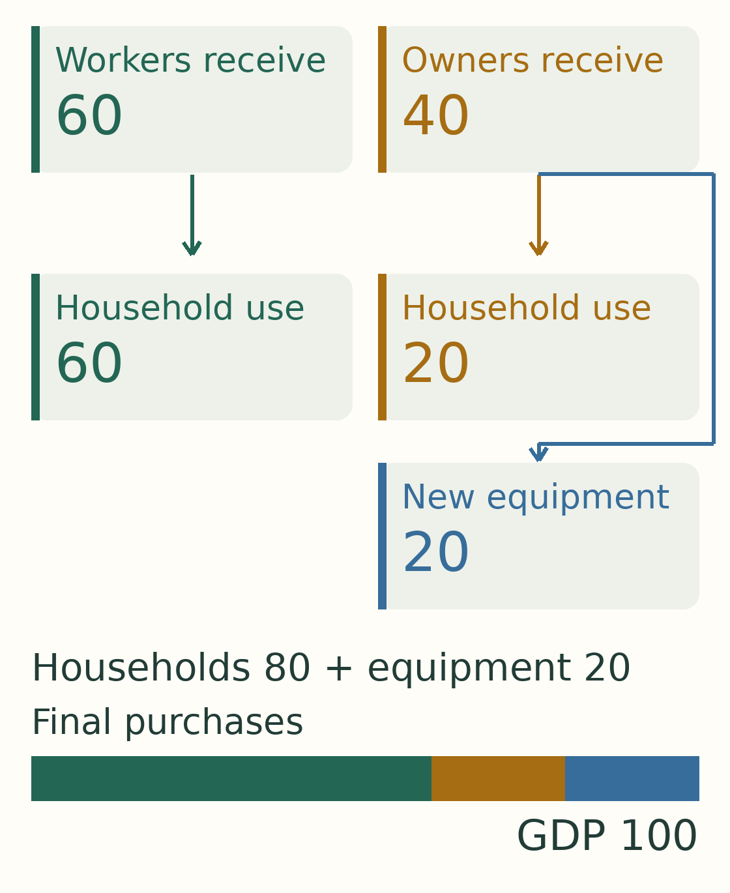
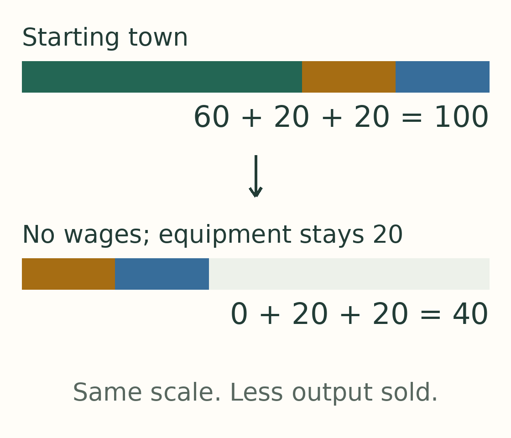
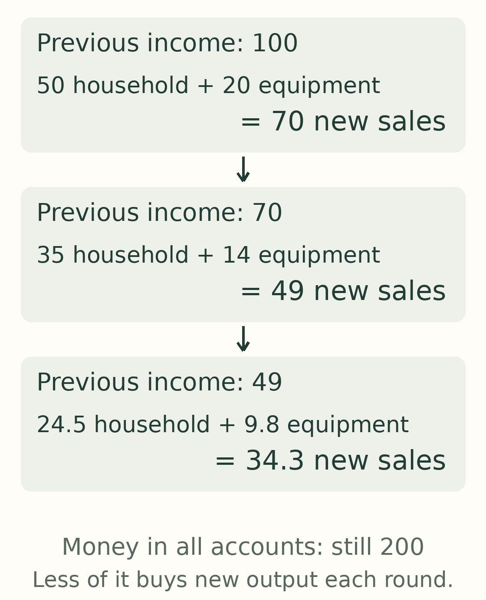
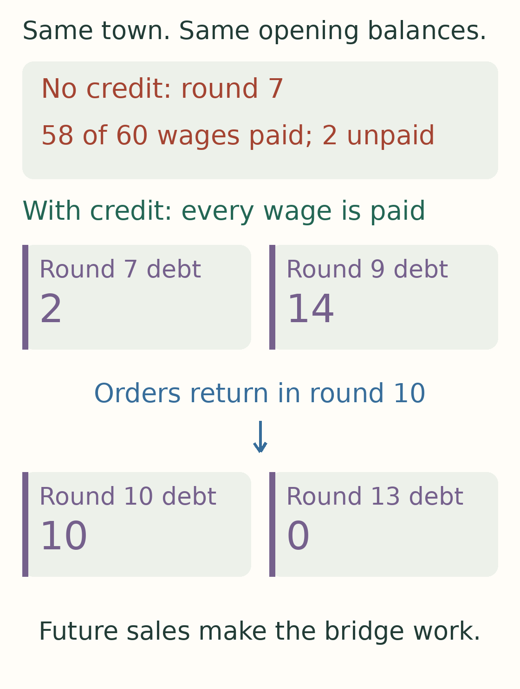
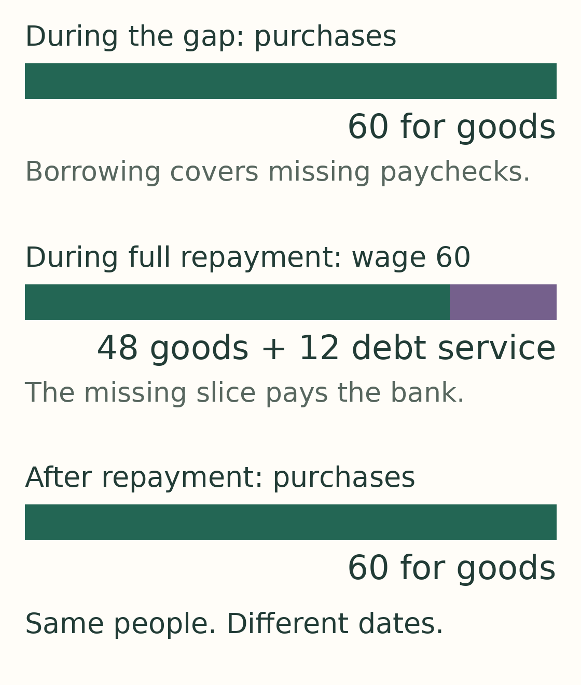
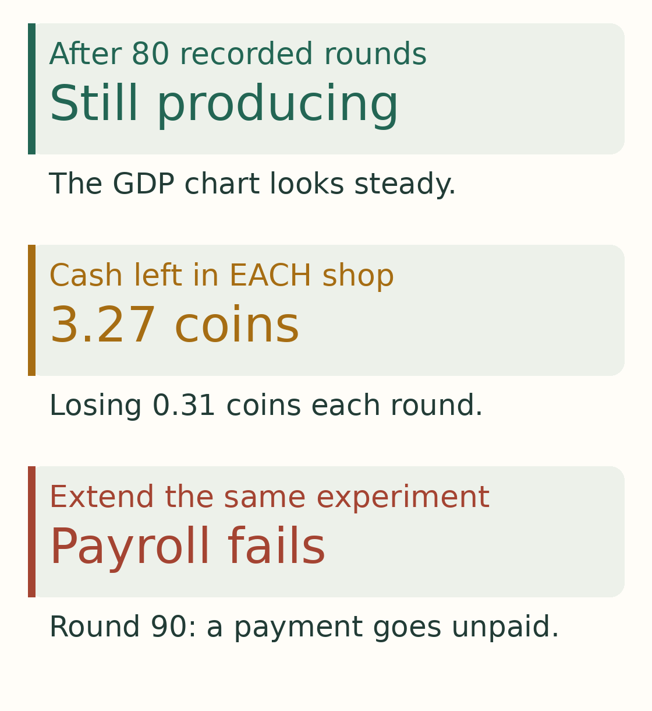
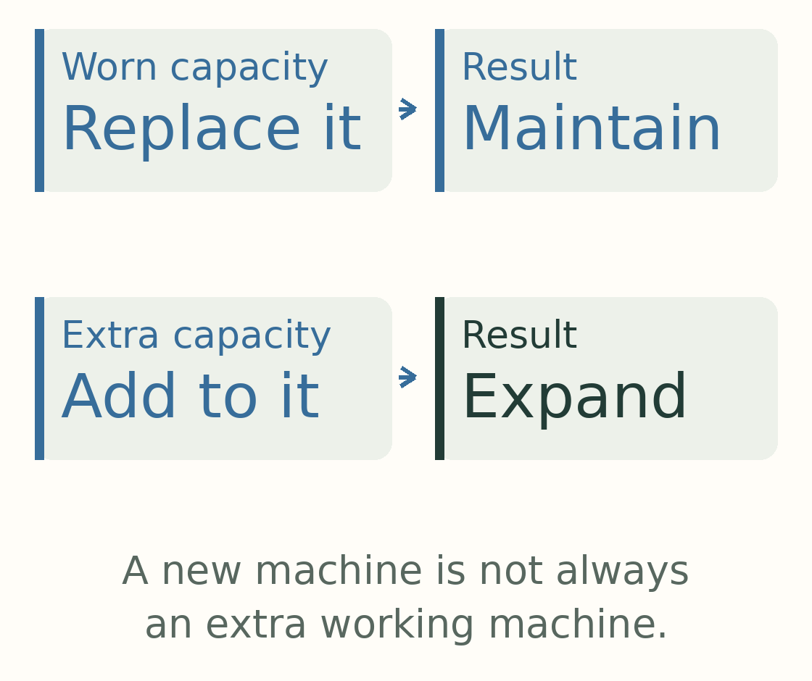
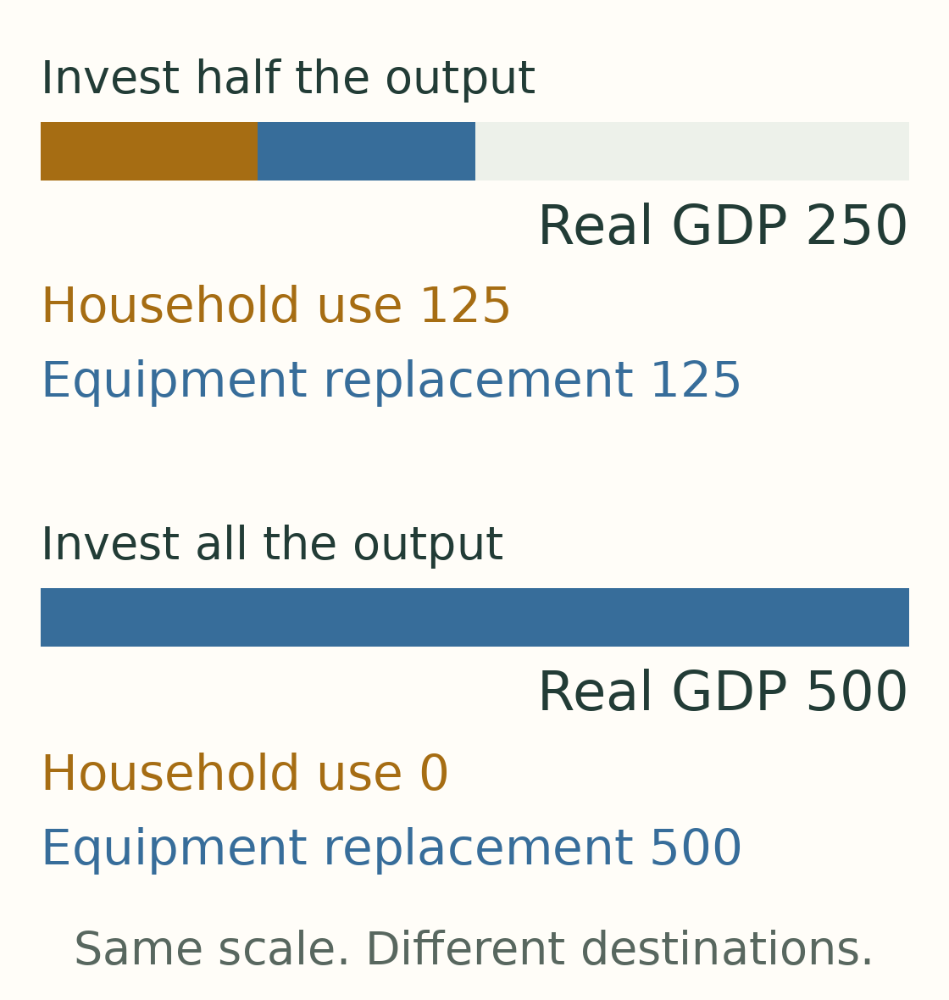

# Who buys what AI makes?

*A small town, ten workers, and ten lessons about an economy that needs less human work.*

**Static edition · [Follow the pictures step by step →](../site/05-who-buys-what-ai-makes-animated.html)**

[Public repository: run the experiments and inspect the results →](https://github.com/krystofmincev-ewise/value-deep-dives/tree/main/studies/toy-economy)

You are thinking about buying a car. Then your employer introduces an AI system that can do part of your job.

Perhaps this is good news. You might finish earlier. Perhaps the car will become cheaper too.

But perhaps your next paycheck will be smaller. Until you know, you keep the old car.

Across town, someone who makes cars sees another customer disappear.

That was the question behind [AI needs a customer](https://krystofmincev.substack.com/p/ai-needs-a-customer): if businesses need fewer workers, who buys what those businesses produce?

We built two small computer experiments to follow the question through. One follows money around ten connected businesses. The other looks more closely at two competing shops as they introduce AI, a little at a time. Separate experiments let us add a bank or let machines accumulate. We will say when we switch experiments; these are different views of an invented town, not one model that contains everything.

The answer is more hopeful, and more demanding, than “no jobs means no growth.” **People do not have to work to buy things. But they do need a way to pay for them.**

Let us follow that distinction from the first AI installation to a town with no jobs at all.

## Meet the town before anything changes

Forget the car for a moment. Our shops sell baskets of useful things: food, clothing, and whatever else people want. Each basket initially costs one coin.

Ten workers receive sixty coins between them each round. The owners receive forty from the businesses. For now, a round just means the next payday and shopping trip; it is not a year.

*One hundred coins of new production generates one hundred coins of income. Sixty goes to workers; forty goes to owners. This is the same hundred seen from two sides, not two separate hundreds.*

Workers spend their sixty on baskets. Owners buy twenty baskets and use their remaining twenty to finance equipment for the businesses. That equipment replaces machines wearing out.

*Keep this picture in mind: sixty for workers' shopping, twenty for owners' shopping, twenty for equipment. No part of the owners' forty is left idle in this starting round.*

The town's GDP is one hundred: eighty of things for people, plus twenty of new equipment. GDP counts new production, including equipment bought by businesses. It does not tell us who enjoys the output.

As prices change, we will mostly talk about **baskets**, so that cheaper prices do not look like less production. When we say *real GDP*, we value the goods at their original prices to measure how much was produced.

Every numerical result below belongs to these invented experiments. They help us understand mechanisms; they do not tell us how likely a particular AI future is. The [appendix](../site/05-appendix.html) holds the full map of assumptions, results and code.

## 1. AI removes tasks. The paycheck is a separate decision.

Now zoom in on two competing shops. Each employs five of our ten workers. An AI supplier and an equipment maker serve them. We simplify those suppliers as already automated.

*This is the closer view used for gradual AI adoption. The ten workers are split between two shops. The starting wages, household purchases and equipment orders match the budget we have just followed.*

At first, making eighty baskets takes ten full human shifts. AI takes over a fifth of the tasks. The same baskets now need eight human shifts. Later, they need six.

*These blocks show work needed for the original eighty baskets. They do not yet tell us how many people have a job or how much anyone earns.*

Imagine a washing machine arriving in a laundry. Finishing the old workload sooner creates a choice. The staff could wash more clothes, go home earlier with the same pay, or lose paid hours.

Our AI shops face that choice too. Ten people might share six paid shifts. Six might keep full shifts while four lose their jobs. Or all ten might keep their salaries and use the spare time to make more goods.

This is our first important separation: **less work required is a technological result. Less income received depends on what happens next.**

For AI, that distinction matters from the first task automated, long before an entire occupation disappears.

## 2. A flat paycheck can buy more. A smaller one might not.

Give both shops the same technology: AI now handles two fifths of their tasks. Reset the town between three versions, changing what happens to pay and freed time.

In the first, workers keep their pay and stay available to make more baskets. The shops spread their wage costs over more potential output and reduce prices under our pricing rule. Workers' sixty coins now buy about sixty-eight baskets.

Nobody needed a pay rise to buy more. The price of a basket fell.

In the second, workers keep their salaries but take shorter shifts. The shops still pay for AI, while keeping their planned output smaller. Their prices rise. Workers get more time off but can buy only about fifty-four baskets. Whether that is a good exchange depends on how much they value the time.

In the third, the shops cut paid hours. Workers' pay falls from sixty coins to thirty-six. Prices fall too, but not enough: workers can buy only about forty-one baskets.

*Read each row as a fresh version of the same town. Compare workers' purchases with the original sixty baskets. The technology is the same; contracts and the use of freed time differ. The layoffs row cuts the same total paid time as shorter hours, but some people lose all their pay instead of everybody losing part.*

The useful question is therefore not just “Will AI make things cheaper?” It is **“Will things become cheaper faster than people's incomes fall?”** A half-price basket is little comfort to somebody whose income has disappeared.

## 3. What looks sensible for one shop can disappoint both.

Return to the version that cuts paid hours. Before adopting, a shop estimates its next profit. Saving wages looks more valuable than the AI bill. The first step appears to lift profit from ten coins to roughly ten and a half.

Its rival sees the same opportunity. Both adopt.

But those workers were also customers. Once both shops have automated two fifths of their tasks, weaker purchasing power has worked its way through the town. Each shop now earns only about five coins.

*The first profit is a forecast for the next step. The later profit is the recorded result after both shops adopt further and household spending changes. They are different moments, not a like-for-like claim about one installation.*

It is like two shopkeepers each thinking, “My customers work somewhere else.” Across the whole town, there is no somewhere else.

Our shops have limited foresight: they use current customer budgets and the rival's existing price. This is how that particular decision rule can backfire, not a proof that every well-informed business would make the same mistake.

Still, it exposes a tension worth watching as AI spreads. A company can capture a saving on its own payroll while part of the cost arrives at other companies' checkouts.

## 4. The money can remain while the customers disappear.

Where did the money go?

Some went to the AI supplier. That invoice is someone else's income. Some may remain in owners' or businesses' accounts instead of being spent again.

*This picture follows coins in the protected-pay version. Shops receive eighty and pay about fourteen to the AI supplier; the roughly sixty-six left covers wages and shop profit. The supplier passes its income to owners. With twenty of equipment purchases, current-price GDP is still one hundred. The AI bill is already inside that total; cheaper baskets let the same coins buy more.*

A coin sitting in an account is still a coin. But it is not currently buying a basket. The same stock of money can support very different amounts of shopping over successive rounds.

To see this clearly, return to the ten-business experiment and remove all wages. Suppose owners spend half their income on household goods, while equipment purchases stay fixed at twenty. The town eventually sells only forty of output: twenty to households, twenty to businesses. Its two hundred coins still exist.

*The missing part of the lower bar is production no longer bought. It is not a pile of coins that has been destroyed. Former workers have no income in this version.*

This does not mean saving always causes a slump. In our starting town, the owners' unconsumed income financed equipment purchases. The distinction is whether money set aside supports another purchase, or simply stays aside under the rules we have chosen.

For the AI story, “the profits went to someone” is the beginning of the answer. We still need to follow what that someone does with them.

## 5. Investment can support the town—and then retreat with it.

Perhaps businesses will keep buying equipment even if households buy less. Those orders pay the equipment maker, which creates income for someone else. Household consumption is not the only source of demand.

But imagine owning a shop with unsold baskets. Would you order more shelving?

Change one rule in the wage-free town: equipment orders now follow sales instead of staying fixed. Owners spend half the previous round's income on consumption, and businesses order equipment worth another fifth. Together, they return seventy percent as new purchases.

*Start at the top. One hundred of income generates seventy of spending. Seventy generates forty-nine. Forty-nine generates about thirty-four. The rule repeats; it is not a one-off loss.*

A smaller market now causes smaller equipment orders, which cause a still smaller market. Eventually, too little replacement also leaves less working equipment.

This is the question behind an AI investment boom: **what keeps the next order worthwhile?** Investment can support today's income. Whether it supports a lasting expansion depends on what the equipment produces, who will buy that output, and whether the purchases remain financeable.

These experiments cannot validate a dollar forecast for AI revenue or capital spending. They tell us which spending and income links such a forecast needs to explain.

## 6. A slower transition buys time. What happens during that time matters.

AI is unlikely to arrive everywhere on one payday. In our experiments, shops can automate in steps, or reach useful stages at different times.

If paid work is shrinking, a slower transition leaves households with more paychecks along the way. They can keep shopping for longer. But in the ten-business tests, spreading the same losses over more rounds does not by itself replace the missing income at the end.

Now reverse the situation. Salaries are protected and AI makes baskets cheaper. Here, waiting means postponing a benefit.

*These paths keep pay protected. The destination is similar, but the number of baskets bought along the way differs. This picture illustrates delayed gains; the wage-loss tests separately illustrate delayed losses.*

Think of moving house in stages. Extra time helps if it lets you arrange somewhere to live. It does not help indefinitely if you never find a destination.

For AI, a gradual transition creates an opportunity to change contracts, ownership or financing before old income disappears. Gradual change alone is not that replacement arrangement.

## 7. A bank can carry spending across a temporary gap.

Give the earlier town a fair bank. No penalties or tricks: the central example even charges no interest.

Equipment orders temporarily stop. An equipment maker still owes wages, but its cash runs out before orders return. Without credit, it misses a payday. With credit, it pays its workers, receives revenue when orders restart, and repays the loan.

*Outstanding debt grows during the interruption and falls after orders return. Each box is a balance at a different date; the boxes should not be added together.*

The bank has changed the outcome. A payment failure was avoidable because the borrower had income on the other side of the gap.

Households can borrow too. But repayment uses income that could otherwise buy things. In our household example, a loan keeps shopping going through two missing paychecks. When wages return, part goes to repayment, so shopping temporarily falls below normal.

*The middle bar divides a restored wage between shopping and debt payments. Borrowing moved some purchases forward; it did not provide a permanent replacement for income.*

If income never returns, a prudent bank refuses the loan. If it lends on a mistaken recovery forecast, someone bears the loss. In one test, forgiveness consumes the bank's capital—the funds its owners had put at risk.

That future income need not be wages. It could be dividends from an automated business. But **credit does not remove the question of who ultimately pays**. These banking tests cover temporary payroll and shopping gaps, not loans that build new productive capacity.

## 8. The town can prosper without jobs—if people still have claims on its output.

Now take the AI-shop experiment to its end: all the shops' productive tasks are automated, and the AI supplier has enough capacity.

Run it twice from matching starting conditions.

In the first version, former workers receive no dividends. Their consumption eventually falls to zero. The machines can make things, but those people cannot buy them.

In the second, former workers are given a right to sixty percent of the businesses' cash dividends once the final automation stage arrives. A dividend is profit paid to an owner. Here, it replaces the paycheck as their route to income.

*Both versions remove the jobs. Only the second gives former workers dividend rights. They buy about eighty-three baskets, compared with sixty before automation. The bars show household baskets only; add twenty of equipment in each version to get the GDP number above it. Sharing dividends is an explicit change in ownership income, not an automatic benefit of AI.*

That is a town with no jobs and more consumption for the former workers. Real GDP is higher too.

The ownership rights are gifted in this experiment; we have not made unemployed people pay for shares with income they no longer have. The original owners still finance the equipment purchases. Nor have we modeled a government transfer system. We are isolating a principle: access to output can come from ownership as well as employment.

There is also a less attractive possibility. In the earlier experiment, owners alone can spend enough to sustain the original GDP while former workers consume nothing. **An economy continuing to produce is not the same thing as everyone continuing to participate.**

## 9. “Still running” is a lower bar than “doing well.”

Suppose a shop responds to falling sales by cutting paid hours. It may avoid missing payroll. That does not mean the town has recovered: its customers may now earn and buy much less.

And a business can look steady while spending its last reserves.

In a more finely spaced AI experiment, one apparently strong result lasts through all eighty planned rounds. Output has settled. But each shop is losing a little cash every round. Extend the same run and it misses payroll in round ninety.

*This is one specific protected-pay run with ample AI capacity and 58% task automation. Eighty rounds were not long enough to reveal its payment failure. The pattern matters more than that particular round number.*

Even a genuine recovery can stop short. In an earlier shock experiment, equipment orders and wages return, but owners' household purchases do not. GDP settles at eighty instead of its original hundred under that spending rule.

These are three different tests: can every bill be paid today; has purchasing recovered; and can the arrangement continue without using up its buffers?

For AI, a stable-looking output chart answers only part of the question. We also need the household budgets and the businesses' accounts underneath it.

## 10. The biggest GDP is not necessarily the best ending.

Finally, suppose we want to make the town as prosperous as possible. Should we simply maximize GDP?

First, we must distinguish what the town *could make* from what it can sell. In one AI-shop test, inherited resources could support one hundred and sixty baskets. At the best tested automation level for that pricing rule, customers actually buy only about ninety-four. More machines do not automatically bring more customers through the door.

*This is a comparison within one declared experiment, not a universal best amount of AI. A different price rule, AI fee or distribution of income changes the result.*

Then there is what GDP counts. Imagine a war destroys a bridge. Rebuilding it is new production, but people have used effort merely to regain a crossing they already had. This is why production and wealth must be kept separate. It does **not** mean war raises GDP overall: destruction also disrupts production. National accounts record exceptional destruction separately from ordinary wear and tear. [The BEA explains the distinction.](https://www.bea.gov/help/faq/1013)

Our machines wear out rather than being destroyed by war. But the same everyday question helps: **are we adding something useful, or using today's output to replace what we lost?**

*New equipment counts as production in either case. Only the extra equipment increases the stock of working machines.*

In a separate long-run machinery experiment, making the machine stock larger eventually gives smaller additional gains. Keeping that stock running also requires more replacements.

One sustainable arrangement produces two hundred and fifty units each round. Half replaces equipment; half is available to households. Another produces five hundred—but needs all five hundred to replace its machinery. Nothing is left for households.

*These arrangements can replace their worn-out equipment indefinitely under one invented technology. This separate calculation assumes the purchases can be financed. The biggest GDP is not the arrangement with the most household consumption. Neither calculation puts a value on free time.*

The extreme makes a simple point. An AI economy full of busy factories, replacement servers and investment orders might report impressive production. We still need to ask what reaches people's lives.

## Back to the car

Return to your employer's AI announcement.

If you keep your income and the car gets cheaper, you may buy it sooner. If you get a shorter week with the same pay, you may welcome the extra time. If wages disappear but dividends take their place, a job need not remain your ticket to the showroom.

If your income disappears without a replacement, you probably keep the old car. A loan might postpone that decision; it cannot settle it forever. Other businesses then experience your employer's saving as a missing customer.

The first paper's concern survives, with a more precise condition. **Growth does not require everyone to keep earning wages. In our town, a lasting market needs purchases that people or businesses can finance. Shared prosperity requires those gains to reach people too.**

The AI system changes what work is necessary. What happens to pay, prices, ownership and investment determines which ending this town gets.

---

[Read the appendix: how the experiments work, detailed results and limitations →](../site/05-appendix.html)

[Explore the AI shops round by round](../site/adoption.html) · [Explore sudden shocks](../site/shocks.html) · [Explore the bank](../site/banking.html)

*Research explainer · 12 October 2026 · Original analysis with Codex assistance. The earlier papers and simulations remain available. No model round represents a calendar year; no simulated frequency is a real-world probability.*
